# HỆ THỐNG QUẢN TRỊ NGUỒN NHÂN LỰC TẬP ĐOÀN VINAMILK (VINAMILK ENTERPRISE HRM)

[](https://www.php.net/)
[](https://www.mysql.com/)
[-brightgreen?logo=phpunit)](https://phpunit.de/)
[-blue)]()
[](https://github.com/)

> **Đơn vị phát triển**: Vinamilk HRM Engineering Team  
> **Repository**: `kysuriaminato-ai/vinamilk`  
> **Kiến trúc cốt lõi**: **PHP 8.2 MVC Thuần** (`app/core`: App, Controller, Model, Database PDO), **MySQL 8.0+**, Bootstrap 5.3, Chart.js 4.  
> **Cam kết hệ thống**: **100% Không dùng .NET**, **Không mock data JavaScript**, 100% dữ liệu thực tế từ cơ sở dữ liệu MySQL qua PDO Prepared Statements, áp dụng phân quyền cây đơn vị đệ quy `scopeByUnit()` và bảo mật toàn diện (CSRF, timing-safe auth, XSS, Audit Logging).

---

## 📑 MỤC LỤC
1. [Cơ cấu Tổ chức 5 Cấp & Phân quyền Cây đơn vị (`scopeByUnit`)](#1-cơ-cấu-tổ-chức-5-cấp--phân-quyền-cây-đơn-vị)
2. [Hướng dẫn Cài đặt & Khởi chạy Hệ thống](#2-hướng-dẫn-cài-đặt--khởi-chạy-hệ-thống)
3. [Danh mục Tài khoản Demo Đúng Dữ liệu Seed 300 Nhân sự](#3-danh-mục-tài-khoản-demo-chuẩn-seed)
4. [Sơ đồ Thực thể Cơ sở Dữ liệu (ERD)](#4-sơ-đồ-thực-thể-cơ-sở-dữ-liệu-erd)
5. [Quy chuẩn Dữ liệu Seed 300 Nhân sự & 24 Tháng Lương/Công](#5-quy-chuẩn-dữ-liệu-seed-300-nhân-sự--24-tháng-lươngcông)
6. [Bộ Kiểm thử Tự động (PHPUnit Test Suite)](#6-bộ-kiểm-thử-tự-động-phpunit-test-suite)
7. [Kịch bản Trình diễn & Đánh giá Hệ thống 10 Phút](#7-kịch-bản-trình-diễn-10-phút-live-demo-walkthrough)
8. [Tích hợp Liên tục CI/CD (GitHub Actions)](#8-tích-hợp-liên-tục-cicd-github-actions)

---

## 🏢 1. CƠ CẤU TỔ CHỨC 5 CẤP & PHÂN QUYỀN CÂY ĐƠN VỊ

Hệ thống được thiết kế theo cấu trúc cây tổ chức 5 cấp thực tế của Tập đoàn Vinamilk:

```
[CẤP 1: TẬP ĐOÀN VINAMILK] (VINAMILK)
  │
  ├── [CẤP 2: KHỐI VĂN PHÒNG] (KHOI_VP)
  │     ├── [CẤP 3: PHÒNG BAN CHUYÊN MÔN] (PB_NHANSU, PB_TAICHINH, PB_IT, PB_MARKETING, PB_QLCL, PB_RD, PB_HANHCHINH)
  │
  ├── [CẤP 2: KHỐI SẢN XUẤT] (KHOI_SX)
  │     ├── [CẤP 3: NHÀ MÁY SỮA BÌNH DƯƠNG] (NM_BD)
  │     │     ├── [CẤP 4: XƯỞNG CHIẾT RÓT TETRA PAK] (NM_BD_XUONG1)
  │     │     │     ├── [CẤP 5: CA SẢN XUẤT 1 - SÁNG] (NM_BD_CA1: 06h - 14h)
  │     │     │     ├── [CẤP 5: CA SẢN XUẤT 2 - CHIỀU] (NM_BD_CA2: 14h - 22h)
  │     │     │     └── [CẤP 5: CA SẢN XUẤT 3 - ĐÊM] (NM_BD_CA3: 22h - 06h sáng)
  │     │     ├── [CẤP 4: XƯỞNG ĐÓNG GÓI] (NM_BD_XUONG2)
  │     │     └── [CẤP 4: PHÒNG QA/QC NHÀ MÁY] (NM_BD_QLCL)
  │     ├── [CẤP 3: NHÀ MÁY SỮA TIÊN SƠN - BẮC NINH] (NM_TS)
  │     ├── [CẤP 3: NHÀ MÁY SỮA THỐNG NHẤT - TP.HCM] (NM_TL)
  │     └── [CẤP 3: NHÀ MÁY SỮA SÀI GÒN] (NM_SG)
  │
  ├── [CẤP 2: KHỐI TRANG TRẠI BÒ SỮA] (KHOI_TT)
  │     ├── [CẤP 3: TRANG TRẠI GREEN FARM TÂY NINH] (TT_GREEN1)
  │     │     ├── [CẤP 4: KHU CHUỒNG TRẠI CÔNG NGHỆ CAO] (TT_TN_KHUCHUONG)
  │     │     └── [CẤP 4: TT VẮT SỮA TỰ ĐỘNG DELAVAL] (TT_TN_VATHSUA)
  │     └── [CẤP 3: TRANG TRẠI GREEN FARM HÀ TĨNH] (TT_GREEN2)
  │
  └── [CẤP 2: KHỐI KINH DOANH & PHÂN PHỐI] (KHOI_KD)
        ├── [CẤP 3: CHI NHÁNH MIỀN BẮC] (CN_BAC)
        ├── [CẤP 3: CHI NHÁNH MIỀN TRUNG] (CN_TRUNG)
        └── [CẤP 3: CHI NHÁNH MIỀN NAM] (CN_NAM)
              ├── [CẤP 4: CHUỖI CỬA HÀNG GIẤC MƠ SỮA VIỆT] (CN_NAM_CHUOIGMSV)
              └── [CẤP 4: KÊNH SIÊU THỊ MT] (CN_NAM_KENHKHACHHANG)
```

### Cơ chế phân quyền cây đơn vị `Model::scopeByUnit()`:
Tất cả các truy vấn đọc, sửa, duyệt hồ sơ nhân sự, bảng lương và chấm công đều áp dụng bộ lọc đơn vị thông qua **MySQL 8 Recursive Common Table Expression (CTE)**:
- Người dùng thuộc vai trò `ADMIN`, `BOD`, `HR_TAPDOAN`: Có quyền truy cập toàn bộ tập đoàn, được tự do chọn đơn vị trực thuộc để lọc.
- Người dùng thuộc vai trò `HR_DONVI` hoặc `QUANLY_TRUCTIEP`: Chỉ được xem và thao tác trên chính đơn vị của mình cùng toàn bộ các đơn vị cấp con/cháu thuộc nhánh cây của mình (ví dụ: HR Nhà máy Bình Dương xem được Xưởng 1, Xưởng 2, Ca 1, Ca 2, Ca 3 nhưng không thể xem nhân sự Nhà máy Tiên Sơn hay Trang trại Tây Ninh).
- Người dùng vai trò `NHANVIEN` (ESS): Chỉ được phép xem bản ghi cá nhân của chính mình.

---

## ⚡ 2. HƯỚNG DẪN CÀI ĐẶT & KHỞI CHẠY HỆ THỐNG

### Yêu cầu tiên quyết:
- **PHP**: Phiên bản 8.2 trở lên (Đã bật các extension: `pdo`, `pdo_mysql`, `mbstring`, `curl`, `openssl`).
- **MySQL**: Phiên bản 8.0 trở lên.
- **Web Server**: Apache / Nginx hoặc PHP Built-in Web Server.

### Bước 1: Chuẩn bị mã nguồn
```bash
git clone https://github.com/kysuriaminato-ai/vinamilk.git
cd vinamilk
```

### Bước 2: Cấu hình kết nối Cơ sở dữ liệu
Hệ thống hỗ trợ cả file cấu hình `app/config/config.php` lẫn biến môi trường `.env`. Nếu sử dụng XAMPP mặc định (MySQL cổng 3306, user `root`, mật khẩu rỗng), hệ thống tự động kết nối mà không cần cấu hình thêm.

Nếu cần tùy chỉnh, tạo file `.env` tại thư mục gốc:
```env
DB_HOST=127.0.0.1
DB_PORT=3306
DB_DATABASE=vinamilk_hrm
DB_USERNAME=root
DB_PASSWORD=
```

### Bước 3: Nạp CSDL & Dữ liệu Seed 300 Nhân sự
Chạy lệnh runner tự động tạo CSDL `vinamilk_hrm`, nạp schema và khởi tạo 300 nhân sự + 24 tháng công/lương:
```bash
# Windows (PowerShell với XAMPP)
& "C:\xampp\php\php.exe" database\migrate_and_seed.php

# Hoặc Linux / MacOS
php database/migrate_and_seed.php
```

Hoặc nạp thủ công bằng MySQL CLI:
```bash
mysql -u root -p -e "CREATE DATABASE IF NOT EXISTS vinamilk_hrm CHARACTER SET utf8mb4 COLLATE utf8mb4_unicode_ci;"
mysql -u root -p vinamilk_hrm < database/vinamilk_hrm.sql
mysql -u root -p vinamilk_hrm < database/migrations/2026_10_12_vinamilk_hrm_full_migration.sql
php database/seeders/seed_300_employees.php
```

### Bước 4: Chạy kiểm thử tự động (PHPUnit)
```bash
# Windows
& "C:\xampp\php\php.exe" phpunit.phar --testdox

# Linux / Composer
composer test
# hoặc: php phpunit.phar --testdox
```
*Kết quả chuẩn: `OK (25 tests, 93 assertions)` - 100% các ca kiểm thử đạt chuẩn.*

### Bước 5: Khởi động máy chủ Web
Khởi động bằng máy chủ tích hợp của PHP:
```bash
# Windows
& "C:\xampp\php\php.exe" -S 127.0.0.1:8080 -t public

# Linux / MacOS
php -S 127.0.0.1:8080 -t public
```
Mở trình duyệt truy cập: **`http://127.0.0.1:8080`**  
Trang đăng nhập hỗ trợ tính năng **1-Click Quick Login** giúp giám khảo trải nghiệm tức thì từng vai trò mà không cần gõ mật khẩu thủ công.

---

## 👥 3. DANH MỤC TÀI KHOẢN DEMO CHUẨN SEED

Toàn bộ tài khoản hệ thống khi khởi tạo đều được kích hoạt cờ bảo mật **`MustChangePassword = 1`** theo tiêu chuẩn an toàn thông tin doanh nghiệp. Người dùng bắt buộc phải thiết lập mật khẩu cá nhân mới khi đăng nhập lần đầu tiên.

| STT | Tài khoản (Username) | Trạng thái bảo mật | Mã Vai Trò | Chức danh & Phạm vi nghiệp vụ | Mã NV | Đơn vị trực thuộc & Cấp thẩm quyền |
| :---: | :--- | :--- | :--- | :--- | :---: | :--- |
| **1** | `admin` | `Yêu cầu đổi MK lần đầu` | `Admin` | **Quản trị hệ thống**: Toàn quyền bảo mật, cấu hình tham số lương, nhật ký kiểm toán. | `VNM-0020` | Trụ sở Tập đoàn (`PB_IT`) - Toàn quyền |
| **2** | `bod.ceo` | `Yêu cầu đổi MK lần đầu` | `BOD` | **Tổng Giám Đốc (CEO)**: Xem Dashboard phân tích HR, định biên, cơ cấu tổ chức toàn quốc. | `VNM-0001` | Ban Điều hành Tập đoàn (`VINAMILK`) |
| **3** | `hr.tapdoan` | `Yêu cầu đổi MK lần đầu` | `HR_TAPDOAN` | **Trưởng phòng HR Tập đoàn**: Quản lý 300 hồ sơ, thuyên chuyển, bổ nhiệm, phê duyệt toàn quốc. | `VNM-0004` | Ban Quản trị Nguồn nhân lực (`PB_NHANSU`) |
| **4** | `ketoan.luong` | `Yêu cầu đổi MK lần đầu` | `KETOAN_LUONG` | **Kế toán Tiền lương**: Chạy tính lương 3P, Biểu thuế 5 bậc 2026, khóa bảng lương bất biến. | `VNM-0013` | Khối Tài chính Kế toán (`PB_TAICHINH`) |
| **5** | `hr.binhduong` | `Yêu cầu đổi MK lần đầu` | `HR_DONVI` | **Nhân sự Nhà máy Bình Dương**: Quản lý 45 nhân sự, HĐLĐ và chấm công NM Bình Dương. | `VNM-0047` | Nhà máy Sữa Mega Bình Dương (`NM_BD`) |
| **6** | `hr.tienson` | `Yêu cầu đổi MK lần đầu` | `HR_DONVI` | **Nhân sự Nhà máy Tiên Sơn**: Quản lý 45 nhân sự NM Tiên Sơn (Bắc Ninh). | `VNM-0092` | Nhà máy Sữa Tiên Sơn (`NM_TS`) |
| **7** | `hr.thongnhat` | `Yêu cầu đổi MK lần đầu` | `HR_DONVI` | **Nhân sự Nhà máy Thống Nhất**: Quản lý 45 nhân sự NM Thống Nhất (TP.HCM). | `VNM-0137` | Nhà máy Sữa Thống Nhất (`NM_TL`) |
| **8** | `hr.saigon` | `Yêu cầu đổi MK lần đầu` | `HR_DONVI` | **Nhân sự Nhà máy Sài Gòn**: Quản lý 45 nhân sự NM Sài Gòn. | `VNM-0182` | Nhà máy Sữa Sài Gòn (`NM_SG`) |
| **9** | `hr.tayninh` | `Yêu cầu đổi MK lần đầu` | `HR_DONVI` | **Nhân sự Trang trại Tây Ninh**: Quản lý 23 nhân sự Trang trại Green Farm Tây Ninh. | `VNM-0227` | Trang trại Green Farm Tây Ninh (`TT_GREEN1`) |
| **10** | `quanly.binhduong` | `Yêu cầu đổi MK lần đầu` | `QUANLY_TRUCTIEP` | **Quản đốc Xưởng Tetra Pak**: Phê duyệt nghỉ phép Cấp 1, xếp ca tuần, xác nhận công. | `VNM-0049` | Xưởng Chiết rót Bình Dương (`NM_BD_XUONG1`) |
| **11** | `congnhan.bd` | `Yêu cầu đổi MK lần đầu` | `NHANVIEN` | **Công nhân Vận hành Ca 1 (ESS)**: Cổng tự phục vụ xem phiếu lương cá nhân, gửi đơn nghỉ phép. | `VNM-0055` | Ca Sản xuất 1 Bình Dương (`NM_BD_CA1`) |

> 💡 **Tài khoản ESS cho toàn bộ nhân sự**: Cả 300 nhân sự đều có tài khoản đăng nhập cá nhân theo định dạng `vnm.0001`, `vnm.0002`, ..., `vnm.0300` với cờ `MustChangePassword = 1` được kích hoạt theo mặc định.

---

## 📊 4. SƠ ĐỒ THỰC THỂ CƠ SỞ DỮ LIỆU (ERD)

```mermaid
erDiagram
    dm_donvi ||--o{ dm_donvi : "MaDV_Cha (Cây đệ quy 5 cấp)"
    dm_donvi ||--o{ nhansu : "thuộc đơn vị"
    dm_chucvu ||--o{ nhansu : "đảm nhiệm chức vụ"
    nhansu ||--o{ users : "tài khoản đăng nhập"
    roles ||--o{ users : "vai trò hệ thống"
    
    nhansu ||--o{ hop_dong_lao_dong : "ký kết hợp đồng"
    nhansu ||--o{ so_du_phep : "quỹ phép theo năm"
    nhansu ||--o{ don_nghi_phep : "nộp đơn xin nghỉ"
    
    ca_lam_viec ||--o{ cham_cong_ngay : "theo ca chuẩn"
    nhansu ||--o{ cham_cong_ngay : "quẹt thẻ hàng ngày"
    nhansu ||--o{ bang_cong_thang : "công tổng hợp tháng"
    
    bang_luong ||--o{ bang_luong_chi_tiet : "chi tiết kỳ lương"
    nhansu ||--o{ bang_luong_chi_tiet : "hưởng lương 3P"
    cau_hinh_luong ||--o{ bang_luong_chi_tiet : "áp tham số pháp lý"
    bieu_thue_tncn ||--o{ bang_luong_chi_tiet : "áp biểu 5 bậc 2026"

    nhansu ||--o{ cap_phat_tai_san : "sử dụng tài sản/PPE"
    nhansu ||--o{ chung_chi_nhan_vien : "sở hữu chứng chỉ"
    users ||--o{ audit_log : "lưu vết hành vi"

    dm_donvi {
        varchar MaDV PK "Mã đơn vị"
        varchar TenDV "Tên đơn vị"
        tinyint CapDV "Cấp đơn vị (1-5)"
        varchar MaDV_Cha FK "Mã đơn vị cấp cha"
        varchar LoaiDV "Loại đơn vị (CongTy, NhaMay, TrangTrai...)"
    }

    nhansu {
        varchar MaNV PK "Mã nhân viên (VNM-xxxx)"
        varchar HoTen "Họ và tên"
        date NgaySinh "Ngày sinh"
        varchar MaDV FK "Đơn vị trực thuộc"
        varchar MaCV FK "Chức vụ"
        tinyint VungLuong "Vùng lương tối thiểu (1-4)"
        tinyint TrangThai "1=Làm việc, 2=Thử việc, 3=Nghỉ, 4=Tạm hoãn"
        date NgayVaoLam "Ngày gia nhập"
        decimal LuongBaoHiem "Lương trần đóng BH"
    }

    users {
        int ID PK
        varchar Username UK "Tên đăng nhập"
        varchar Password "Hash Bcrypt"
        varchar MaNV FK "Mã nhân sự"
        varchar MaDV FK "Đơn vị gán"
        int RoleID FK "ID vai trò"
        varchar RoleCode "Admin, BOD, HR_DONVI..."
    }

    hop_dong_lao_dong {
        bigint id PK
        varchar ma_nv FK "Mã nhân viên"
        varchar so_hd "Số hợp đồng"
        varchar loai_hd "THU_VIEC, XAC_DINH_THOI_HAN, KHONG_XAC_DINH"
        date tu_ngay "Hiệu lực từ"
        date den_ngay "Hiệu lực đến"
        decimal luong_can_ban "Lương P1"
        varchar trang_thai "HIEU_LUC, HET_HAN, DA_CHAM_DUT"
    }

    so_du_phep {
        bigint id PK
        varchar ma_nv FK
        smallint nam "Năm phép (2025, 2026)"
        decimal phep_tieu_chuan "12 ngày"
        decimal phep_tham_nien "+1 ngày mỗi 5 năm"
        decimal phep_da_nghi "Đã nghỉ"
        decimal phep_cho_duyet "Đang tạm giữ"
        decimal phep_con_lai "Còn lại"
    }

    don_nghi_phep {
        bigint id PK
        varchar ma_don UK
        varchar ma_nv FK
        varchar loai_nghi "PHEP_NAM, NGHI_OM, THAI_SAN..."
        date tu_ngay
        date den_ngay
        decimal so_ngay_nghi
        varchar trang_thai "CHO_DUYET_C1, CHO_DUYET_C2, DA_DUYET, TU_CHOI"
        varchar nguoi_duyet_c1 FK
        varchar nguoi_duyet_c2 FK
    }

    cham_cong_ngay {
        bigint id PK
        varchar ma_nv FK
        date ngay "Ngày làm việc"
        varchar ma_ca FK "CA_1, CA_2, CA_3, CA_HANH_CHINH"
        time gio_vao
        time gio_ra
        decimal cong_thuc_te "1.0, 0.5, 0.0"
        varchar loai_cong "DI_LAM, NGHI_PHEP_NAM, NGHI_OM_BHXH..."
        varchar trang_thai_duyet "HOP_LE, CHO_GIAI_TRINH"
    }

    bang_cong_thang {
        bigint id PK
        tinyint thang
        smallint nam
        varchar ma_nv FK
        decimal cong_chuan_thang "26.0"
        decimal cong_thuc_te "Công thực tế"
        decimal nghi_phep_huong_luong "Phép hưởng lương"
        decimal tong_gio_ot "Tổng giờ OT"
        varchar trang_thai "TO_TRUONG_XAC_NHAN, KHOA_CONG"
    }

    bang_luong {
        int id PK
        varchar ky_luong "YYYY-MM"
        varchar ma_dv FK
        int tong_nhan_su "Số nhân sự được tính"
        decimal tong_quy_luong "Tổng lương chi trả"
        decimal tong_thuc_linh "Tổng thực lĩnh"
        varchar trang_thai "DANG_TINH, CHO_DUYET, DA_CHI_TRA"
    }

    bang_luong_chi_tiet {
        bigint id PK
        int bang_luong_id FK
        varchar ma_nv FK
        decimal luong_p1_hop_dong "Lương P1 vị trí"
        decimal luong_p2_hieu_suat "Lương P2 hiệu suất"
        decimal luong_p3_kpi "Lương P3 KPI"
        decimal luong_ot "Thù lao làm thêm giờ"
        decimal ot_mien_thue "50% phần vượt trội miễn thuế"
        decimal tong_bao_hiem_nv "BHXH 8%, BHYT 1.5%, BHTN 1%"
        decimal thue_tncn "Thuế TNCN Biểu 5 bậc 2026"
        decimal thuc_linh "Thực lĩnh cuối cùng"
    }

    audit_log {
        bigint id PK
        varchar username
        varchar hanh_dong "CREATE, UPDATE, DELETE, APPROVE, LOCK_PAYROLL"
        varchar bang_tac_dong "nhansu, bang_luong, don_nghi_phep..."
        longtext du_lieu_cu
        longtext du_lieu_moi
        varchar ip_address
        datetime thoi_gian
    }
```



---

## 📈 5. QUY CHUẨN DỮ LIỆU SEED 300 NHÂN SỰ & 24 THÁNG LƯƠNG/CÔNG

Kịch bản `database/seeders/seed_300_employees.php` khởi tạo dữ liệu mô phỏng doanh nghiệp lớn đạt độ trung thực cao:

### 1. Phân bổ chính xác theo tỷ lệ cơ cấu:
- **Trụ sở Tập đoàn (15% = 45 nhân sự)**: Ban Tổng Giám đốc (`VINAMILK`) và 8 phòng ban chuyên môn (`PB_NHANSU`, `PB_TAICHINH`, `PB_IT`, `PB_MARKETING`, `PB_QLCL`, `PB_RD`, `PB_HANHCHINH`, `PB_PHAPLUAT`).
- **4 Nhà máy chế biến (60% = 180 nhân sự)**: 45 nhân sự / nhà máy:
  - `NM_BD` (Nhà máy Mega Bình Dương - KCN Mỹ Phước 2): Xưởng Chiết rót Tetra Pak, Xưởng Đóng gói, 3 Ca sản xuất, Phòng QA.
  - `NM_TS` (Nhà máy Sữa Tiên Sơn - Bắc Ninh).
  - `NM_TL` (Nhà máy Sữa Thống Nhất - TP.HCM).
  - `NM_SG` (Nhà máy Sữa Sài Gòn - KCN Hiệp Phước).
- **2 Trang trại bò sữa (15% = 45 nhân sự)**:
  - `TT_GREEN1` (Trang trại Green Farm Tây Ninh - 23 nhân sự): Khu Chuồng trại công nghệ cao, Trung tâm Vắt sữa tự động DeLaval.
  - `TT_GREEN2` (Trang trại Green Farm Hà Tĩnh - 22 nhân sự).
- **Chi nhánh kinh doanh (10% = 30 nhân sự)**:
  - `CN_BAC` (Chi nhánh Miền Bắc - 10 nhân sự).
  - `CN_TRUNG` (Chi nhánh Miền Trung - 10 nhân sự).
  - `CN_NAM` (Chi nhánh Miền Nam - 10 nhân sự): Kênh siêu thị MT, Chuỗi cửa hàng Giấc Mơ Sữa Việt.

### 2. Đầy đủ các trạng thái nhân sự:
- **TrangThai = 1 (Đang làm việc)**: ~85% (254 nhân sự).
- **TrangThai = 2 (Thử việc)**: ~7% (21 nhân sự - mới gia nhập từ tháng 08-09/2026, loại HĐ: `THU_VIEC`, hưởng 85% lương).
- **TrangThai = 3 (Đã thôi việc)**: ~4.7% (14 nhân sự - nghỉ việc trong năm 2025/2026).
- **TrangThai = 4 (Tạm hoãn HĐLĐ / Nghỉ thai sản)**: ~3.3% (11 nhân sự - hưởng chế độ thai sản/BHXH).

### 3. Dữ liệu 24 tháng liên tục (11/2024 đến 10/2026):
- **Bảng lương (`bang_luong`)**: 24 kỳ lương liên tiếp. Các kỳ cũ đều ở trạng thái `DA_CHI_TRA` / `DA_KHOA`, kỳ hiện tại (10/2026) ở trạng thái `CHO_DUYET`.
- **Bản ghi chi tiết lương (`bang_luong_chi_tiet`)**: 6.603 bản ghi chi tiết với đầy đủ các cấu phần P1, P2, P3, phụ cấp ăn ca 730.000đ, OT phân loại thường/đêm có miễn thuế 50%, bảo hiểm trần 46.800.000đ và Thuế TNCN Biểu 5 bậc 2026.
- **Bảng công tháng (`bang_cong_thang`)**: 6.647 bản ghi tổng hợp công, phép, OT và giờ ca đêm.
- **Chấm công hàng ngày (`cham_cong_ngay`)**: 3.025 bản ghi chi tiết các ngày trong tháng 10/2026 theo từng ca sản xuất (Ca 1, Ca 2, Ca 3 đêm, Ca hành chính).

---

## 🧪 6. BỘ KIỂM THỬ TỰ ĐỘNG (PHPUNIT TEST SUITE)

Hệ thống được kiểm thử tự động toàn diện qua 4 bộ test unit & workflow:

```bash
& "C:\xampp\php\php.exe" phpunit.phar --testdox
```

```text
PHPUnit 10.5.66 by Sebastian Bergmann and contributors.

Runtime:       PHP 8.2.12
Configuration: phpunit.xml

Contract Warning (Tests\Unit\ContractWarning)
 ✔ Cảnh báo hợp đồng sắp hết hạn trong 60 ngày
 ✔ Cảnh báo hợp đồng sắp hết hạn trong 30 ngày
 ✔ Phát hiện hợp đồng đã quá hạn hiệu lực
 ✔ Ngăn chặn ký HĐ xác định thời hạn lần thứ 3 (Điều 20 BLLĐ 2019)
 ✔ Cho phép gia hạn sang hợp đồng không xác định thời hạn

Leave Approval Workflow (Tests\Unit\LeaveApprovalWorkflow)
 ✔ Tự động cộng ngày phép theo thâm niên (+1 ngày mỗi 5 năm)
 ✔ Tạo đơn nghỉ phép trên ESS và tạm giữ số dư phép chờ duyệt
 ✔ Ngăn chặn tạo đơn khi số ngày nghỉ vượt quá số dư phép khả dụng
 ✔ Quy trình phê duyệt 2 cấp (C1 -> C2) và tự động ghi vào chấm công ngày
 ✔ Nhắc nhở đơn quá hạn 48 giờ và cho phép thiết lập ủy quyền duyệt thay
 ✔ Từ chối đơn nghỉ phép và tự động hoàn trả số dư phép khả dụng

Payroll Service (Tests\Unit\PayrollService)
 ✔ Tính lương P1 theo hợp đồng và ngày công thực tế
 ✔ Tính lương P2 hiệu suất vị trí
 ✔ Tính lương P3 theo điểm đánh giá KPI hoàn thành
 ✔ Tính phụ cấp ăn ca miễn thuế theo quy định
 ✔ Tính tiền làm thêm giờ (OT) và tách phần chênh lệch miễn thuế TNCN
 ✔ Trích nộp bảo hiểm bắt buộc có áp trần pháp lý (46.800.000 đ)
 ✔ Tính thuế TNCN theo Biểu lũy tiến 5 bậc năm 2026
 ✔ Trừ khoản khấu trừ bồi hoàn tài sản hỏng hóc/mất mát
 ✔ Khóa bảng lương bất biến (Chặn mọi hành vi sửa trực tiếp sau khi duyệt)

Scope By Unit (Tests\Unit\ScopeByUnit)
 ✔ Chặn truy cập khi chưa đăng nhập hệ thống
 ✔ Ban Giám Đốc và Admin xem toàn bộ dữ liệu toàn tập đoàn
 ✔ Ban Giám Đốc lọc dữ liệu chi tiết theo từng đơn vị cụ thể
 ✔ Nhân sự Đơn vị bị giới hạn trong cây đơn vị trực thuộc
 ✔ Nhân sự Đơn vị bị chặn khi cố tình lọc trái quyền sang đơn vị khác
 ✔ Nhân viên ESS chỉ xem hồ sơ và phiếu lương của chính mình

OK (25 tests, 93 assertions)
```

---

## ⏱️ 7. KỊCH BẢN TRÌNH DIỄN 10 PHÚT (LIVE DEMO WALKTHROUGH)

Kịch bản được thiết kế chuẩn xác để trình bày cho Ban giám khảo / Giảng viên trong đúng 10 phút:

### ⏱️ Phút 00:00 - 01:30 | Đăng nhập Đa vai trò & Trực quan Cây Tổ chức 5 Cấp
1. Truy cập `http://127.0.0.1:8080/auth/login`. Nhấn nút **1-Click Login** vai trò **BOD (Tổng Giám Đốc)**.
2. Tại **Dashboard BOD** (`/dashboard`):
   - Quan sát biểu đồ tổng quan 300 nhân sự toàn quốc: Trụ sở 15%, 4 Nhà máy 60%, 2 Trang trại 15%, Chi nhánh 10%.
   - Biểu đồ biến thiên quỹ lương 24 tháng (11/2024 -> 10/2026).
3. Truy cập **Cơ cấu Tổ chức** (`/organization`): Trình diễn cây đệ quy 5 cấp từ Tập đoàn -> Khối -> Nhà máy/Trang trại -> Phân xưởng -> Ca sản xuất.

### ⏱️ Phút 01:30 - 03:00 | Hồ sơ Nhân sự & Cảnh báo Pháp lý HĐLĐ (Điều 20 BLLĐ 2019)
1. Đăng xuất, đăng nhập vai trò **HR_DONVI (`hr.binhduong`)**:
   - Chứng minh cơ chế `scopeByUnit()`: Danh sách nhân sự chỉ hiển thị 45 nhân sự thuộc Nhà máy Mega Bình Dương. Khi chọn thử sang đơn vị khác, hệ thống tự động khóa an toàn.
2. Truy cập **Quản lý Hợp đồng** (`/contracts`):
   - Xem widget đếm thông minh: HĐ sắp hết hạn 60 ngày, 30 ngày, Quá hạn.
   - Thử nghiệm chức năng tái ký HĐLĐ: Trình diễn việc hệ thống **chặn đứng hành vi ký HĐ xác định thời hạn lần thứ 3** (bắt buộc phải chuyển sang Không xác định thời hạn theo Điều 20 Bộ luật Lao động 2019).

### ⏱️ Phút 03:00 - 05:00 | Quy trình Duyệt Nghỉ phép 2 Cấp & Đồng bộ Tự động vào Chấm công
1. Đăng nhập vai trò **NHANVIEN (Công nhân ESS - `congnhan.bd`)**:
   - Truy cập **Đơn nghỉ phép** (`/leaves/create`): Xem số dư phép năm 2026 (tính chuẩn thâm niên). Nộp đơn xin nghỉ phép 2 ngày.
   - Trạng thái đơn: Chuyển sang `CHO_DUYET_C1`, quỹ phép tự động chuyển 2 ngày vào trạng thái `Tạm giữ (Chờ duyệt)`.
2. Đăng xuất, đăng nhập vai trò **QUANLY_TRUCTIEP (`quanly.binhduong`)**:
   - Truy cập **Duyệt đơn từ** (`/leaves/approval`): Thấy đơn của công nhân, nhấn **"Duyệt Cấp 1"**. Trạng thái chuyển sang `CHO_DUYET_C2`.
3. Đăng xuất, đăng nhập vai trò **HR Nhà máy (`hr.binhduong`)**:
   - Phê duyệt Cấp 2 hoàn tất.
   - Kiểm tra ngay tại **Bảng chấm công ngày** (`/attendance`): Hệ thống đã **tự động ghi nhận 2 ngày công phép (loại `NGHI_PHEP_NAM`, công 1.0, trạng thái `HOP_LE`)**, không cần nhập tay!

### ⏱️ Phút 05:00 - 07:00 | Quản lý Chấm công, Xếp ca 3 Ca & Bảng công tháng
1. Đăng nhập vai trò **QUANLY_TRUCTIEP (`quanly.binhduong`)**:
   - Truy cập **Ma trận Xếp ca Tuần** (`/attendance/roster`): Trực quan lưới phân ca cho 3 ca sản xuất (Ca 1 Sáng, Ca 2 Chiều, Ca 3 Đêm).
   - Truy cập **Bảng công tháng tổng hợp** (`/attendance/monthly`): Xem tổng công chuẩn, công thực tế, giờ OT tách ngày thường/ngày nghỉ và phụ cấp làm việc ca đêm (+30%).
   - Thực hiện thao tác Tổ trưởng xác nhận công.

### ⏱️ Phút 07:00 - 08:30 | Động cơ Lương 3P, Biểu thuế TNCN 2026 & Khóa Lương Bất biến
1. Đăng nhập vai trò **KẾ TOÁN LƯƠNG (`ketoan.luong`)**:
   - Truy cập **Bảng thanh toán lương** (`/payroll`):
     - Mở bảng lương tháng 10/2026: Trình diễn công thức lương **3P chuẩn Vinamilk**:
       - **P1 (Position)**: Lương theo vị trí chức danh và hợp đồng lao động.
       - **P2 (Performance)**: Thù lao hiệu suất công việc.
       - **P3 (Person/KPI)**: Thưởng hiệu quả theo kết quả KPI thực tế.
     - **Bảo hiểm**: Trích nộp BHXH (8%), BHYT (1.5%), BHTN (1%) tự động chặn trần 46.800.000đ.
     - **Thuế TNCN**: Tính chính xác theo **Biểu lũy tiến từng phần 5 bậc mới nhất áp dụng từ 01/01/2026** (Bậc 1: $\le$ 10 triệu - 5%; Bậc 2: 10-30 triệu - 10%...).
   - Nhấn **"In Phiếu lương A4"**: Xuất bản in Payslip chuẩn nhận diện Vinamilk, hỗ trợ in PDF sắc nét.
   - Trình diễn tính năng **Khóa bảng lương (Lock Payroll)**: Sau khi khóa, hệ thống kích hoạt cơ chế bất biến, ngăn chặn tuyệt đối mọi hành vi sửa đổi dữ liệu lương kỳ đã chốt.

### ⏱️ Phút 08:30 - 10:00 | AI Chuyên gia Phân tích Rủi ro Nghỉ việc & Nhật ký Kiểm toán (Audit Log)
1. Đăng nhập vai trò **BOD (`bod.ceo`)**:
   - Truy cập **AI Chuyên gia Dự báo Rủi ro & Định biên** (`/ai-expert`):
     - Xem ma trận AI chấm điểm nguy cơ thôi việc (Turnover Risk Score) dựa trên thâm niên, tăng lương, biến động OT và điểm KPI.
     - Khuyến nghị chiến lược giữ chân nhân tài và tối ưu hóa định biên theo từng nhà máy.
2. Đăng nhập vai trò **ADMIN (`admin`)**:
   - Truy cập **Nhật ký Kiểm toán (Audit Log)** (`/system/audit`):
     - Chứng minh mọi thao tác vừa thực hiện trong buổi demo (Đăng nhập, Tạo đơn nghỉ, Duyệt đơn, Tính lương, Khóa bảng lương) đều được ghi nhận chi tiết với thời gian thực, IP client, Username, bảng tác động và dữ liệu Before/After JSON.

---

## 🚀 8. TÍCH HỢP LIÊN TỤC CI/CD (GITHUB ACTIONS)

Tập tin workflow [`.github/workflows/ci.yml`](file:///.github/workflows/ci.yml) được cấu hình tự động kích hoạt trên mọi thao tác `push` và `pull_request`:

1. **PHP Syntax Linting (`php -l`)**: Quét đệ quy toàn bộ thư mục `app`, `routes`, `tests`, `database` đảm bảo 100% tệp PHP sạch lỗi cú pháp.
2. **Khởi tạo MySQL 8.0 Service Container**: Tạo container MySQL 8.0 độc lập với health check tự động.
3. **Import SQL Schemas**: Tự động import tệp cơ sở `database/vinamilk_hrm.sql` và migration `database/migrations/2026_10_12_vinamilk_hrm_full_migration.sql`.
4. **Seed 300 Nhân sự & 24 Tháng Lương/Công**: Chạy `database/seeders/seed_300_employees.php` nạp dữ liệu mẫu vào container.
5. **Thực thi PHPUnit Test Suite**: Chạy toàn bộ 25 bài test unit & workflow qua `php phpunit.phar --testdox`.

---

## 🔒 9. TIÊU CHUẨN BẢO MẬT & PHÁP LÝ VIỆT NAM

- **Chống tấn công CSRF**: 100% form POST đều xác thực token CSRF sinh ngẫu nhiên an toàn qua `csrf_field()`.
- **Chống tấn công XSS**: 100% biến đầu ra giao diện được xử lý qua hàm an toàn `e()` (`htmlspecialchars`).
- **Bảo mật xác thực Timing-Safe**: Mật khẩu hash qua `password_hash()` với `PASSWORD_BCRYPT`, so khớp token bằng `hash_equals()`.
- **Tuân thủ Bộ luật Lao động 2019**:
  - Không quá 2 lần ký HĐ xác định thời hạn (Điều 20).
  - Tách thuế làm thêm giờ OT (Phần thù lao cao hơn giờ làm việc bình thường được miễn thuế TNCN - Điểm i Khoản 1 Điều 3 Thông tư 111/2013/TT-BTC).
  - Trợ cấp ăn ca trần 730.000 đ/tháng được miễn thuế TNCN.
  - Áp dụng mức trần đóng BHXH/BHYT bằng 20 lần mức lương cơ sở (2.340.000 đ $\times$ 20 = 46.800.000 đ) theo Nghị định 73/2024/NĐ-CP.
  - Áp dụng biểu thuế TNCN 5 bậc hiện hành từ năm 2026.

---

**© 2026 Công ty Cổ phần Sữa Việt Nam (Vinamilk) - Bản quyền thuộc về Vinamilk HRM Engineering Team.**
