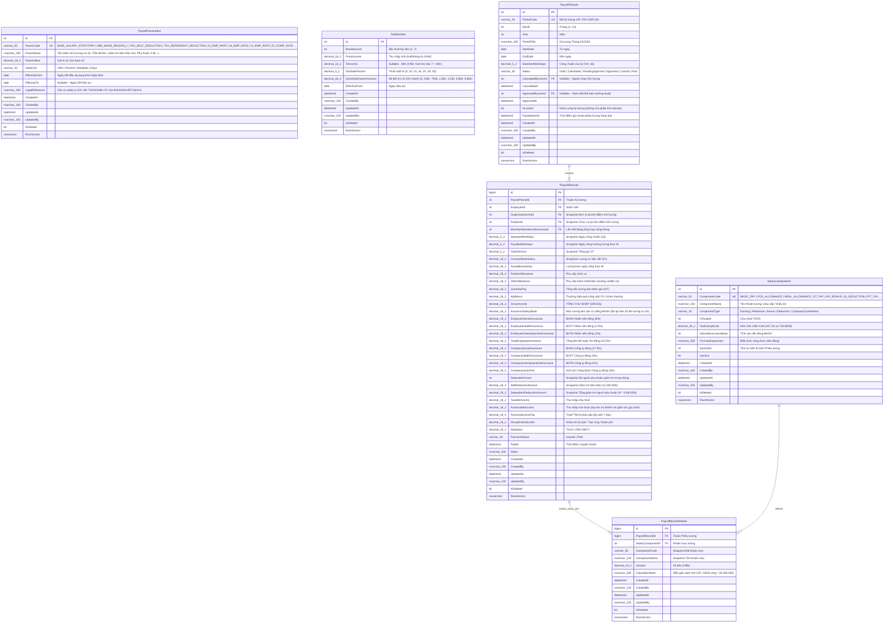

# THIẾT KẾ CƠ SỞ DỮ LIỆU & SƠ ĐỒ THỰC THỂ LIÊN KẾT (ERD) CHUẨN 3NF – VINAMILK HRM (.NET 8 & SQL SERVER)

**Dự án:** Hệ thống Quản trị Nguồn nhân lực Doanh nghiệp – Vinamilk Enterprise HRM  
**Hệ quản trị CSDL đích:** Microsoft SQL Server 2022 / Azure SQL Database  
**ORM & Truy vấn:** Entity Framework Core 8 (Code-First, Fluent API) + Dapper (Báo cáo thống kê hiệu năng cao)  
**Chuẩn thiết kế:** Chuẩn hóa dạng 3 (3NF - Third Normal Form), Đa tầng bảo mật (RBAC + Data Scope + Mã hóa AES-256 theo Nghị định 13/2023/NĐ-CP)  
**Phiên bản:** 1.0 (Đầu ra Phiên 1)

---

## 1. QUY ƯỚC THIẾT KẾ CSDL (DATABASE CONVENTIONS)

### 1.1. Quy ước đặt tên (Naming Conventions)
1. **Schema (Phân vùng vật lý/logic):**
   - `identity`: Quản lý Tài khoản, Vai trò, Quyền hạn, Phạm vi dữ liệu, Phiên đăng nhập, Consent dữ liệu cá nhân (`Users`, `Roles`, `Permissions`, ...).
   - `core`: Cơ cấu tổ chức, Danh mục dùng chung, Hồ sơ Nhân sự 360°, Hợp đồng, Quá trình công tác, Điều chuyển, Khen thưởng/Kỷ luật (`OrganizationUnits`, `Employees`, `LaborContracts`, ...).
   - `time`: Ca làm việc, Phân ca, Chấm công chi tiết/tổng hợp, OT, Nghỉ phép (`WorkShifts`, `DailyAttendances`, `LeaveRequests`, ...).
   - `payroll`: Tham số lương/BHXH/Thuế, Kỳ lương, Bảng lương 3P, Chi tiết khoản lương (`PayrollParameters`, `PayrollPeriods`, `PayrollRecords`, ...).
   - `talent`: Tuyển dụng (ATS), Onboarding/Offboarding, Tài sản cấp phát, Đào tạo (LMS), Đánh giá KPI/OKR (`RecruitmentRequests`, `Candidates`, `TrainingCourses`, `EmployeeKpiEvaluations`, ...).
   - `sys`: Workflow Engine phê duyệt động, Thông báo Realtime, Nhật ký Audit, Khuyến nghị AI (`WorkflowDefinitions`, `WorkflowInstances`, `AuditLogs`, ...).
2. **Tên bảng (Table Names):** Tiếng Anh, dạng danh từ số nhiều **PascalCase** (ví dụ: `Employees`, `OrganizationUnits`, `LaborContracts`).
3. **Tên cột (Column Names):** Tiếng Anh, **PascalCase**:
   - Khóa chính (Primary Key): `Id` (`INT IDENTITY(1,1)` cho bảng danh mục/nghiệp vụ chính; `BIGINT IDENTITY(1,1)` cho bảng log/chấm công tần suất lớn như `AuditLogs`, `AttendanceLogs`, `DailyAttendances`).
   - Khóa ngoại (Foreign Key): `<TênThựcThểThamChiếu>Id` (ví dụ: `EmployeeId`, `OrganizationUnitId`, `PositionId`, `ParentUnitId`).
   - Cờ trạng thái kiểu Boolean (`BIT`): Bắt đầu bằng `Is`, `Has`, `Can`, `Allow` (ví dụ: `IsDeleted`, `IsLocked`, `IsTaxable`, `HasUnionFee`).
4. **Ràng buộc (Constraints & Indexes):**
   - Primary Key: `PK_<TableName>`
   - Foreign Key: `FK_<TableName>_<ReferencedTableName>_<ColumnName>`
   - Unique Index: `UQ_<TableName>_<ColumnNames>` (kèm mệnh đề `WHERE IsDeleted = 0` trên SQL Server để hỗ trợ Soft Delete mà không bị xung đột mã khi tạo lại bản ghi đã xóa mềm).
   - Non-Clustered Index: `IX_<TableName>_<ColumnNames>`

### 1.2. Các cột bắt buộc trên mọi bảng (`BaseAuditableEntity`)
Theo quy chuẩn kiến trúc bắt buộc của dự án, **100% các bảng** kế thừa từ `BaseAuditableEntity<TKey>` trong `Vinamilk.HRM.Domain` đều có 7 cột chuẩn sau:

| Tên cột | Kiểu dữ liệu SQL Server | Ràng buộc | Ý nghĩa & Cơ chế tự động trong EF Core 8 |
| :--- | :--- | :--- | :--- |
| `Id` | `INT` hoặc `BIGINT IDENTITY(1,1)` | `PRIMARY KEY` | Khóa chính tự tăng (Surrogate Key), tách biệt khỏi Mã nghiệp vụ (`EmployeeCode`, `ContractNumber`, ...). |
| `CreatedAt` | `DATETIME2(7)` | `NOT NULL DEFAULT SYSUTCDATETIME()` | Thời điểm tạo bản ghi (tự động gán qua `AuditableEntityInterceptor`). |
| `CreatedBy` | `NVARCHAR(100)` | `NOT NULL DEFAULT 'SYSTEM'` | Username / Mã người tạo bản ghi (lấy từ `ICurrentUserService`). |
| `UpdatedAt` | `DATETIME2(7)` | `NULL` | Thời điểm cập nhật gần nhất (tự động gán khi `EntityState.Modified`). |
| `UpdatedBy` | `NVARCHAR(100)` | `NULL` | Username / Mã người cập nhật gần nhất. |
| `IsDeleted` | `BIT` | `NOT NULL DEFAULT 0` | Cờ xóa mềm (Soft Delete). Tự động áp dụng `HasQueryFilter(x => !x.IsDeleted)` toàn cục. |
| `RowVersion` | `ROWVERSION` (`TIMESTAMP`) | `NOT NULL` | Token kiểm soát truy cập đồng thời lạc quan (Optimistic Concurrency Control - `.IsRowVersion()`). |

### 1.3. Quy ước Kiểu dữ liệu & Bảo mật Dữ liệu nhạy cảm (Nghị định 13/2023/NĐ-CP)
- **Chuỗi tiếng Việt:** Luôn dùng `NVARCHAR(n)` (không dùng `VARCHAR` cho tên, địa chỉ, ghi chú).
- **Mã định danh nghiệp vụ (Code):** Dùng `VARCHAR(30)` hoặc `NVARCHAR(30)` (ví dụ: `EmployeeCode = 'VNM001'`, `UnitCode = 'DV001'`).
- **Tiền tệ (Lương, Phụ cấp, Thưởng, Thuế, BHXH):** Dùng `DECIMAL(18, 2)` (tuyệt đối không dùng `FLOAT` hay `REAL` để tránh sai số làm tròn).
- **Tỷ lệ phần trăm / Hệ số / Ngày công:** Dùng `DECIMAL(8, 4)` cho hệ số lương/tỷ lệ đóng BHXH, `DECIMAL(5, 2)` cho số ngày công/số giờ OT/số ngày phép.
- **Mã hóa dữ liệu cá nhân nhạy cảm (PII Encryption):**
  - Các trường `CitizenIdNumber` (Số CCCD), `BankAccountNumber` (Số tài khoản ngân hàng), `PersonalTaxCode` (Mã số thuế TNCN) được lưu dưới dạng mã hóa đối xứng **AES-256-GCM** thông qua EF Core `ValueConverter` (`NVARCHAR(512)`).
  - Để phục vụ tìm kiếm chính xác và kiểm tra trùng (`Unique Constraint`) mà không cần giải mã toàn bảng, bổ sung cột băm định danh `CitizenIdHash` (`CHAR(64)` - HMAC-SHA256) có đánh `UNIQUE INDEX`.

---

## 2. BẢNG ÁNH XẠ CHUYỂN ĐỔI TỪ MYSQL CŨ SANG SQL SERVER MỚI (MIGRATION MAPPING)

Bảng dưới đây đối chiếu toàn bộ 28 bảng trong MySQL hiện tại (`vinamilk_hrm` + `vinamilk_hris`) sang cấu trúc chuẩn hóa 3NF trên SQL Server (`VinamilkHRM`), phục vụ viết `LegacySqlSeeder` ở Phiên 2 (giữ nguyên toàn bộ 55 nhân viên, 16 đơn vị, 11 chức vụ, 5 ngạch lương, lịch sử công tác, bảng công, bảng lương):

| STT | Bảng MySQL cũ (`vinamilk_hrm` / `hris`) | Bảng SQL Server mới (`VinamilkHRM`) | Thay đổi chuẩn hóa 3NF & Cải tiến kiến trúc |
| :---: | :--- | :--- | :--- |
| 1 | `users` | `identity.Users` | Bổ sung `EmployeeId` (FK chuẩn), `PasswordHash`, `TwoFactorEnabled`, `AccessFailedCount`, `LockoutEnd`, `RefreshToken`. |
| 2 | `roles` | `identity.Roles` | Bổ sung `RoleCode`, `DataScopeType` (`All`, `UnitAndSubUnits`, `OwnUnit`, `SelfOnly`). |
| 3 | `permissions` | `identity.Permissions` | Chuẩn hóa mã quyền dạng `<Module>.<Action>` (VD: `Employees.View`, `Payroll.Approve`). |
| 4 | `role_permissions` | `identity.RolePermissions` | Bảng trung gian N-N giữa `Roles` và `Permissions`, kèm `BaseAuditableEntity`. |
| 5 | `menu_items` | `sys.MenuItems` | Liên kết `PermissionCode` để ẩn/hiện menu động theo quyền thực tế của người dùng. |
| 6 | `lich_su_truy_cap` | `sys.AuditLogs` | Nâng cấp lưu `TableName`, `RecordId`, `ActionType`, `OldValuesJson`, `NewValuesJson`, `IpAddress`, `UserAgent`. |
| 7 | `dm_donvi` + `departments` | `core.OrganizationUnits` | Hợp nhất 2 bảng; hỗ trợ đệ quy `ParentUnitId`, `UnitLevel` (`Company`, `Division`, `Department`, `Team`, `Factory`, `Farm`), `TreePath` (`/1/4/12/`). |
| 8 | `dm_chucvu` | `core.Positions` | Bổ sung `PositionLevel`, `PositionGroup`, `ManagementAllowance` (`DECIMAL(18,2)`). |
| 9 | `dm_ngach` | `core.SalaryScales` & `core.SalarySteps` | Tách bảng `dm_ngach` (đang lưu cố định cột `Bac1`..`Bac5` vi phạm 1NF) thành 2 bảng chuẩn 3NF: `SalaryScales` (Ngạch) và `SalarySteps` (Bậc lương 1..N). |
| 10 | `dm_trinhdo` | `core.EducationLevels` | Chuẩn hóa danh mục trình độ học vấn/chuyên môn (`TD01`..`TD06`). |
| 11 | `dm_ktkl` | `core.RewardDisciplineCategories` | Chuẩn hóa danh mục hình thức Khen thưởng / Kỷ luật và mức tiền mặc định. |
| 12 | `nhansu` + `employees` | `core.Employees` | Hợp nhất; tách khóa chính `Id (INT)` và `EmployeeCode ('VNM001')`; tách thông tin hợp đồng sang `LaborContracts`, người phụ thuộc sang `EmployeeDependents`. |
| 13 | `contracts` (`contracts.sql`) | `core.LaborContracts` & `core.ContractAddendums` | Quản lý vòng đời Hợp đồng lao động (Thử việc, 12T, 36T, KTH) và Phụ lục hợp đồng; thay thế cách lưu đè trên bảng `nhansu`. |
| 14 | `qt_congtac` | `core.EmploymentHistories` | Lưu lịch sử quá trình công tác trong và ngoài công ty. |
| 15 | `qt_bonhiem` + `qt_thuyenchuyen` | `core.PersonnelTransfers` | Hợp nhất quy trình Điều chuyển / Bổ nhiệm / Miễn nhiệm có trạng thái phê duyệt và sinh Số quyết định tự động. |
| 16 | `qt_luong` | `core.SalaryProgressions` | Quá trình diễn biến lương, nâng bậc, điều chỉnh lương cơ bản/lương 3P. |
| 17 | `qt_ktkl` | `core.RewardDisciplines` | Quyết định Khen thưởng / Kỷ luật, thêm cờ `SyncToPayrollPeriodId` để tự động cộng/trừ vào kỳ lương. |
| 18 | `chamcong` | `time.MonthlyAttendanceSummaries` | Bảng tổng hợp công tháng (Đã khóa công, công chuẩn, công thực tế, phép, lễ, không lương, giờ OT 150%/200%/300%). |
| 19 | `bang_cham_cong_chitiet` | `time.DailyAttendances` | Bảng chấm công chi tiết từng ngày, liên kết `WorkShiftId`, lưu giờ `CheckInTime`, `CheckOutTime`, `LateMinutes`, `EarlyLeaveMinutes`. |
| 20 | `don_xin_nghi` + `leave_requests` | `time.LeaveRequests` & `time.LeaveBalances` | Chuẩn hóa đơn xin nghỉ phép gắn với `LeaveTypeId`, `WorkflowInstanceId` và bảng quỹ phép năm `LeaveBalances`. |
| 21 | `bangluong` | `payroll.PayrollPeriods`, `payroll.PayrollRecords`, `payroll.PayrollRecordDetails` | Tách Kỳ lương (`PayrollPeriods` có trạng thái `Draft` → `Approved` → `Locked`) và Phiếu lương nhân viên (`PayrollRecords`), lưu snapshot tham số thuế/BHXH tại thời điểm tính. |
| 22 | `de_xuat_tuyen_dung` | `talent.RecruitmentRequests` | Yêu cầu tuyển dụng theo định biên phòng ban (`Headcount`). |
| 23 | `tintuyendung` | `talent.JobPostings` | Tin đăng tuyển dụng liên kết từ `RecruitmentRequests`. |
| 24 | `hoso_ungvien` | `talent.Candidates` | Hồ sơ ứng viên Kanban (`Applied` → `Screening` → `Interview` → `Offered` → `Hired` → `ConvertedEmployeeId`). |
| 25 | `ketqua_phongvan` | `talent.Interviews` | Lịch phỏng vấn và phiếu chấm điểm ứng viên của hội đồng phỏng vấn. |
| 26 | `dm_khoa_dao_tao` | `talent.TrainingCourses` & `talent.TrainingClasses` | Tách Danh mục khóa học (`TrainingCourses`) và Lớp/Kế hoạch tổ chức đào tạo (`TrainingClasses`). |
| 27 | `qt_daotao` | `talent.TrainingEnrollments` | Học viên đăng ký/tham gia lớp đào tạo, điểm thi, chứng chỉ, chi phí và cam kết phục vụ. |
| 28 | `kpi_metrics` | `talent.EvaluationCycles`, `talent.EmployeeKpiEvaluations`, `talent.EmployeeKpiItems` | Chuẩn hóa Chu kỳ đánh giá KPI, Phiếu đánh giá KPI (Tự đánh giá → Quản lý đánh giá → Điểm chốt & Xếp loại) và Chi tiết từng chỉ tiêu. |
| 29 | `ai_recommendations` | `sys.AiRecommendations` | Lưu trữ đề xuất từ Rule-based Engine & LLM phục vụ quyết định nhân sự (Nâng bậc, Giữ chân, Tuyển dụng, Đào tạo). |

---

## 3. SƠ ĐỒ ERD TỔNG THỂ CHUẨN 3NF (MERMAID `erDiagram`)

Để đảm bảo tính trực quan và độ chi tiết kỹ thuật cao nhất cho hơn 55 bảng trong toàn hệ thống, sơ đồ ERD được trình bày gồm **1 Sơ đồ Kiến trúc Liên kết Tổng thể (Master Relationship Overview)** và **6 Sơ đồ ERD Chi tiết theo từng Phân hệ (Domain Schemas)**.

### 3.1. Sơ đồ Liên kết Tổng thể Giữa các Phân hệ (Master ERD Overview)

```mermaid
erDiagram
    %% PHÂN HỆ CORE HR & TỔ CHỨC
    OrganizationUnits ||--o{ OrganizationUnits : "ParentUnitId"
    OrganizationUnits ||--o{ Employees : "OrganizationUnitId"
    Positions ||--o{ Employees : "PositionId"
    SalarySteps ||--o{ Employees : "SalaryStepId"
    SalaryScales ||--|{ SalarySteps : "SalaryScaleId"
    EducationLevels ||--o{ Employees : "EducationLevelId"

    %% HỒ SƠ 360 & HỢP ĐỒNG
    Employees ||--o{ EmployeeDependents : "EmployeeId"
    Employees ||--o{ EmployeeDocuments : "EmployeeId"
    Employees ||--o{ EmployeeCertificates : "EmployeeId"
    Employees ||--o{ LaborContracts : "EmployeeId"
    LaborContracts ||--o{ ContractAddendums : "LaborContractId"
    Employees ||--o{ EmploymentHistories : "EmployeeId"
    Employees ||--o{ PersonnelTransfers : "EmployeeId"
    Employees ||--o{ SalaryProgressions : "EmployeeId"
    Employees ||--o{ RewardDisciplines : "EmployeeId"

    %% IDENTITY & SECURITY
    Employees |o--o| Users : "EmployeeId"
    Users ||--o{ UserRoles : "UserId"
    Roles ||--o{ UserRoles : "RoleId"
    Roles ||--o{ RolePermissions : "RoleId"
    Permissions ||--o{ RolePermissions : "PermissionId"
    Users ||--o{ UserDataScopes : "UserId"
    OrganizationUnits ||--o{ UserDataScopes : "OrganizationUnitId"
    Employees ||--o{ DataPrivacyConsents : "EmployeeId"

    %% CHẤM CÔNG & NGHỈ PHÉP
    WorkShifts ||--o{ ShiftSchedules : "WorkShiftId"
    Employees ||--o{ ShiftSchedules : "EmployeeId"
    Employees ||--o{ DailyAttendances : "EmployeeId"
    Employees ||--o{ MonthlyAttendanceSummaries : "EmployeeId"
    Employees ||--o{ OvertimeRequests : "EmployeeId"
    Employees ||--o{ LeaveBalances : "EmployeeId"
    Employees ||--o{ LeaveRequests : "EmployeeId"
    LeaveTypes ||--o{ LeaveRequests : "LeaveTypeId"

    %% LƯƠNG 3P, BHXH & THUẾ TNCN
    PayrollPeriods ||--|{ PayrollRecords : "PayrollPeriodId"
    Employees ||--o{ PayrollRecords : "EmployeeId"
    MonthlyAttendanceSummaries ||--o| PayrollRecords : "MonthlyAttendanceSummaryId"
    PayrollRecords ||--|{ PayrollRecordDetails : "PayrollRecordId"
    SalaryComponents ||--o{ PayrollRecordDetails : "SalaryComponentId"

    %% TUYỂN DỤNG, ONBOARDING, ĐÀO TẠO & KPI
    OrganizationUnits ||--o{ RecruitmentRequests : "OrganizationUnitId"
    RecruitmentRequests ||--o{ JobPostings : "RecruitmentRequestId"
    JobPostings ||--o{ Candidates : "JobPostingId"
    Candidates ||--o{ Interviews : "CandidateId"
    Candidates |o--o| Employees : "ConvertedEmployeeId"
    Employees ||--o{ EmployeeOnboardingTasks : "EmployeeId"
    Employees ||--o{ EmployeeAssetAssignments : "EmployeeId"
    Assets ||--o{ EmployeeAssetAssignments : "AssetId"
    TrainingCourses ||--o{ TrainingClasses : "TrainingCourseId"
    TrainingClasses ||--o{ TrainingEnrollments : "TrainingClassId"
    Employees ||--o{ TrainingEnrollments : "EmployeeId"
    EvaluationCycles ||--o{ EmployeeKpiEvaluations : "EvaluationCycleId"
    Employees ||--o{ EmployeeKpiEvaluations : "EmployeeId"
    EmployeeKpiEvaluations ||--|{ EmployeeKpiItems : "EmployeeKpiEvaluationId"

    %% WORKFLOW ENGINE & AI
    WorkflowDefinitions ||--|{ WorkflowSteps : "WorkflowDefinitionId"
    WorkflowDefinitions ||--o{ WorkflowInstances : "WorkflowDefinitionId"
    WorkflowInstances ||--o{ WorkflowApprovalLogs : "WorkflowInstanceId"
    Employees ||--o{ AiRecommendations : "EmployeeId"
```



---

### 3.2. Phân hệ 1: Quản trị Định danh, Phân quyền RBAC, Data Scope & Bảo mật (Schema: `identity` & `sys`)

Đáp ứng yêu cầu RBAC theo Permission (Policy-based), phân quyền dữ liệu theo Phòng ban/Đơn vị (`UserDataScopes`), Bảo mật 2FA, Khóa tài khoản, Nhật ký AuditLog và Tuân thủ Nghị định 13/2023/NĐ-CP (`DataPrivacyConsents`).

```mermaid
erDiagram
    Users {
        int Id PK
        varchar_50 Username UK "Tên đăng nhập (duy nhất)"
        nvarchar_150 Email UK "Email công vụ"
        nvarchar_500 PasswordHash "Mật khẩu băm PBKDF2/Argon2"
        int EmployeeId FK "Nullable - Liên kết Hồ sơ nhân sự"
        bit IsActive "Đang kích hoạt"
        bit TwoFactorEnabled "Bật xác thực 2 lớp (2FA)"
        nvarchar_256 TwoFactorSecret "Khóa TOTP mã hóa"
        int AccessFailedCount "Số lần nhập sai mật khẩu"
        datetime2 LockoutEnd "Thời điểm hết khóa tài khoản"
        datetime2 LastLoginAt "Lần đăng nhập cuối"
        datetime2 PasswordChangedAt "Lần đổi mật khẩu cuối"
        bit MustChangePassword "Bắt buộc đổi MK lần đầu"
        datetime2 CreatedAt
        nvarchar_100 CreatedBy
        datetime2 UpdatedAt
        nvarchar_100 UpdatedBy
        bit IsDeleted
        rowversion RowVersion
    }

    Roles {
        int Id PK
        varchar_50 RoleCode UK "ADMIN, HR_MANAGER, DEPT_HEAD, ACCOUNTANT, EMPLOYEE"
        nvarchar_100 RoleName "Tên vai trò tiếng Việt"
        nvarchar_500 Description "Mô tả vai trò"
        varchar_30 DefaultDataScope "All | UnitTree | OwnUnit | SelfOnly"
        bit IsSystemRole "Vai trò hệ thống không được xóa"
        datetime2 CreatedAt
        nvarchar_100 CreatedBy
        datetime2 UpdatedAt
        nvarchar_100 UpdatedBy
        bit IsDeleted
        rowversion RowVersion
    }

    Permissions {
        int Id PK
        varchar_100 PermissionCode UK "VD: Employees.View, Payroll.Approve"
        varchar_50 ModuleName "Module: Employees, Attendance, Payroll..."
        varchar_30 ActionName "Action: View, Create, Edit, Delete, Approve, Export"
        nvarchar_200 DisplayName "Tên hiển thị tiếng Việt"
        int SortOrder "Thứ tự hiển thị"
        datetime2 CreatedAt
        nvarchar_100 CreatedBy
        datetime2 UpdatedAt
        nvarchar_100 UpdatedBy
        bit IsDeleted
        rowversion RowVersion
    }

    UserRoles {
        int Id PK
        int UserId FK
        int RoleId FK
        datetime2 CreatedAt
        nvarchar_100 CreatedBy
        datetime2 UpdatedAt
        nvarchar_100 UpdatedBy
        bit IsDeleted
        rowversion RowVersion
    }

    RolePermissions {
        int Id PK
        int RoleId FK
        int PermissionId FK
        datetime2 CreatedAt
        nvarchar_100 CreatedBy
        datetime2 UpdatedAt
        nvarchar_100 UpdatedBy
        bit IsDeleted
        rowversion RowVersion
    }

    UserDataScopes {
        int Id PK
        int UserId FK "Người dùng được phân quyền dữ liệu"
        int OrganizationUnitId FK "Đơn vị/Phòng ban được phép truy cập"
        bit IncludeSubUnits "Bao gồm các đơn vị cấp dưới"
        datetime2 CreatedAt
        nvarchar_100 CreatedBy
        datetime2 UpdatedAt
        nvarchar_100 UpdatedBy
        bit IsDeleted
        rowversion RowVersion
    }

    UserSessions {
        bigint Id PK
        int UserId FK
        varchar_500 RefreshTokenHash "Băm Refresh Token"
        varchar_64 IpAddress "Địa chỉ IP đăng nhập"
        nvarchar_500 UserAgent "Trình duyệt / Thiết bị"
        datetime2 ExpiresAt "Thời điểm hết hạn"
        datetime2 RevokedAt "Thời điểm thu hồi"
        datetime2 CreatedAt
        nvarchar_100 CreatedBy
        datetime2 UpdatedAt
        nvarchar_100 UpdatedBy
        bit IsDeleted
        rowversion RowVersion
    }

    DataPrivacyConsents {
        int Id PK
        int EmployeeId FK "Nhân viên xác nhận"
        varchar_30 PolicyVersion "Phiên bản Chính sách BVDLCN (VD: v1.0-ND13)"
        bit IsConsented "Đồng ý xử lý dữ liệu cá nhân"
        datetime2 ConsentedAt "Thời điểm đồng ý"
        varchar_64 IpAddress "IP lúc xác nhận"
        nvarchar_500 ConsentNote "Ghi chú / Phạm vi đồng ý"
        datetime2 CreatedAt
        nvarchar_100 CreatedBy
        datetime2 UpdatedAt
        nvarchar_100 UpdatedBy
        bit IsDeleted
        rowversion RowVersion
    }

    AuditLogs {
        bigint Id PK
        int UserId FK "Nullable - Người thực hiện"
        nvarchar_100 Username "Snapshot tên tài khoản"
        varchar_50 ModuleName "Phân hệ tác động"
        varchar_30 ActionType "Create | Update | Delete | Approve | Lock | Export | ViewSensitive"
        varchar_100 EntityName "Tên bảng / Entity (VD: Employees, PayrollRecords)"
        varchar_50 EntityId "Khóa chính bản ghi bị tác động"
        nvarchar_max OldValuesJson "Giá trị trước khi sửa (JSON)"
        nvarchar_max NewValuesJson "Giá trị sau khi sửa (JSON)"
        nvarchar_500 AffectedColumns "Danh sách cột thay đổi"
        varchar_64 IpAddress "Địa chỉ IP"
        nvarchar_500 UserAgent "User-Agent"
        datetime2 CreatedAt
        nvarchar_100 CreatedBy
        datetime2 UpdatedAt
        nvarchar_100 UpdatedBy
        bit IsDeleted
        rowversion RowVersion
    }

    Users ||--o{ UserRoles : "has"
    Roles ||--o{ UserRoles : "assigned_to"
    Roles ||--o{ RolePermissions : "grants"
    Permissions ||--o{ RolePermissions : "belongs_to"
    Users ||--o{ UserDataScopes : "scoped_to"
    Users ||--o{ UserSessions : "maintains"
    Users ||--o{ AuditLogs : "writes"
```



---

### 3.3. Phân hệ 2: Core HR – Cơ cấu Tổ chức Đa cấp, Hồ sơ 360°, Hợp đồng & Biến động Nhân sự (Schema: `core`)

Chuẩn hóa hoàn toàn bảng `dm_donvi`, `dm_ngach` (tách thành `SalaryScales` và `SalarySteps`), `nhansu`, `contracts`, `qt_congtac`, `qt_bonhiem`, `qt_thuyenchuyen`, `qt_luong`, `qt_ktkl`, bổ sung `EmployeeDependents`, `EmployeeDocuments`, `EmployeeCertificates`.

```mermaid
erDiagram
    OrganizationUnits {
        int Id PK
        varchar_30 UnitCode UK "Mã đơn vị (DV001..DV016)"
        nvarchar_200 UnitName "Tên đơn vị/phòng ban/nhà máy/trang trại"
        varchar_30 UnitType "HeadOffice | Division | Department | Factory | Branch | Farm | Team"
        int UnitLevel "Cấp tổ chức (1: Công ty, 2: Khối/Chi nhánh, 3: Phòng/NM, 4: Tổ)"
        int ParentUnitId FK "Đơn vị cấp trên trực tiếp (Self-referencing)"
        varchar_250 TreePath "Đường dẫn phân cấp Materialized Path: /1/3/8/"
        int ManagerEmployeeId FK "Nullable - Trưởng đơn vị hiện tại"
        nvarchar_300 Address "Địa chỉ đơn vị"
        varchar_30 Phone "Điện thoại liên hệ"
        varchar_20 CostCenterCode "Mã trung tâm chi phí kế toán"
        int PlannedHeadcount "Định biên nhân sự năm"
        int SortOrder "Thứ tự hiển thị trên sơ đồ tổ chức"
        bit IsActive "Đang hoạt động"
        datetime2 CreatedAt
        nvarchar_100 CreatedBy
        datetime2 UpdatedAt
        nvarchar_100 UpdatedBy
        bit IsDeleted
        rowversion RowVersion
    }

    Positions {
        int Id PK
        varchar_30 PositionCode UK "Mã chức vụ (CV01..CV11)"
        nvarchar_150 PositionName "Tên chức vụ (Tổng Giám đốc, Trưởng phòng...)"
        varchar_30 PositionGroup "Executive | Director | Manager | Specialist | Staff | Worker"
        int PositionLevel "Cấp bậc chức danh (1..10)"
        decimal_18_2 DefaultPositionAllowance "Phụ cấp chức vụ mặc định (VNĐ)"
        nvarchar_1000 JobDescription "Mô tả công việc chuẩn"
        bit IsActive
        datetime2 CreatedAt
        nvarchar_100 CreatedBy
        datetime2 UpdatedAt
        nvarchar_100 UpdatedBy
        bit IsDeleted
        rowversion RowVersion
    }

    SalaryScales {
        int Id PK
        varchar_30 ScaleCode UK "Mã ngạch lương (NG01..NG05)"
        nvarchar_150 ScaleName "Tên ngạch (Chuyên viên cao cấp, Kỹ sư, Công nhân...)"
        int ReviewCycleMonths "Chu kỳ xét nâng bậc (12 hoặc 24 tháng)"
        nvarchar_500 Description "Mô tả ngạch lương"
        bit IsActive
        datetime2 CreatedAt
        nvarchar_100 CreatedBy
        datetime2 UpdatedAt
        nvarchar_100 UpdatedBy
        bit IsDeleted
        rowversion RowVersion
    }

    SalarySteps {
        int Id PK
        int SalaryScaleId FK "Thuộc Ngạch lương"
        int StepOrder "Thứ tự bậc lương (1, 2, 3, 4, 5...)"
        nvarchar_50 StepName "Tên bậc (Bậc 1, Bậc 2...)"
        decimal_18_2 StandardSalary "Mức lương chuẩn của bậc (VNĐ)"
        decimal_8_4 SalaryCoefficient "Hệ số lương tham chiếu"
        datetime2 CreatedAt
        nvarchar_100 CreatedBy
        datetime2 UpdatedAt
        nvarchar_100 UpdatedBy
        bit IsDeleted
        rowversion RowVersion
    }

    EducationLevels {
        int Id PK
        varchar_30 LevelCode UK "Mã trình độ (TD01..TD06)"
        nvarchar_100 LevelName "Tiến sĩ, Thạc sĩ, Đại học, Cao đẳng, Trung cấp..."
        int RankOrder "Thứ tự xếp hạng trình độ"
        datetime2 CreatedAt
        nvarchar_100 CreatedBy
        datetime2 UpdatedAt
        nvarchar_100 UpdatedBy
        bit IsDeleted
        rowversion RowVersion
    }

    Employees {
        int Id PK
        varchar_30 EmployeeCode UK "Mã nhân viên (VNM001..VNM055)"
        nvarchar_150 FullName "Họ và tên đầy đủ"
        varchar_10 Gender "Male | Female | Other"
        date DateOfBirth "Ngày sinh"
        nvarchar_512 CitizenIdEncrypted "Số CCCD (Mã hóa AES-256-GCM)"
        char_64 CitizenIdHash UK "HMAC-SHA256 của CCCD để tìm kiếm/check trùng"
        date CitizenIdIssueDate "Ngày cấp CCCD"
        nvarchar_200 CitizenIdIssuePlace "Nơi cấp CCCD"
        nvarchar_50 Ethnicity "Dân tộc (Kinh...)"
        nvarchar_50 Religion "Tôn giáo"
        varchar_20 MaritalStatus "Single | Married | Divorced | Widowed"
        nvarchar_200 PlaceOfOrigin "Quê quán"
        nvarchar_300 PermanentAddress "Hộ khẩu thường trú"
        nvarchar_300 CurrentAddress "Địa chỉ liên hệ hiện tại"
        varchar_20 PhoneNumber "Số điện thoại di động"
        varchar_150 WorkEmail UK "Email công ty (@vinamilk.com.vn)"
        varchar_150 PersonalEmail "Email cá nhân"
        nvarchar_512 BankAccountEncrypted "Số tài khoản ngân hàng (Mã hóa AES-256)"
        nvarchar_150 BankName "Tên ngân hàng"
        nvarchar_150 BankBranch "Chi nhánh ngân hàng"
        nvarchar_512 TaxCodeEncrypted "Mã số thuế TNCN (Mã hóa AES-256)"
        varchar_30 SocialInsuranceNumber "Số sổ BHXH"
        varchar_30 HealthInsuranceNumber "Số thẻ BHYT"
        nvarchar_200 HealthInsurancePlace "Nơi đăng ký KCB ban đầu"
        int OrganizationUnitId FK "Đơn vị/Phòng ban hiện tại"
        int PositionId FK "Chức vụ hiện tại"
        int DirectManagerId FK "Nullable - Quản lý trực tiếp (Self-referencing)"
        int EducationLevelId FK "Trình độ học vấn cao nhất"
        nvarchar_150 Major "Chuyên ngành đào tạo"
        int SalaryStepId FK "Ngạch/Bậc lương hiện tại"
        decimal_18_2 BaseSalary "Mức lương cơ bản thỏa thuận hiện tại (P1)"
        decimal_18_2 PositionAllowance "Phụ cấp chức vụ hiện hưởng"
        decimal_18_2 OtherAllowance "Phụ cấp trách nhiệm/độc hại/khác"
        date HireDate "Ngày vào làm việc"
        date OfficialDate "Ngày chính thức"
        date TerminationDate "Nullable - Ngày nghỉ việc/nghỉ hưu"
        varchar_30 WorkStatus "Probation | Official | MaternityLeave | UnpaidLeave | Resigned | Retired"
        varchar_30 CurrentContractType "Probation | Fixed12M | Fixed36M | Indefinite"
        nvarchar_300 AvatarUrl "Đường dẫn ảnh thẻ nhân viên"
        bit IsUnionMember "Có tham gia Công đoàn"
        datetime2 CreatedAt
        nvarchar_100 CreatedBy
        datetime2 UpdatedAt
        nvarchar_100 UpdatedBy
        bit IsDeleted
        rowversion RowVersion
    }

    EmployeeDependents {
        int Id PK
        int EmployeeId FK "Nhân viên"
        nvarchar_150 FullName "Họ tên người phụ thuộc"
        varchar_30 Relationship "Child | Spouse | Father | Mother | Other"
        date DateOfBirth "Ngày sinh"
        nvarchar_512 CitizenIdEncrypted "Số CCCD/Mã định danh người phụ thuộc (Mã hóa)"
        nvarchar_512 TaxCodeEncrypted "Mã số thuế người phụ thuộc"
        bit IsTaxDeductible "Được tính giảm trừ gia cảnh thuế TNCN (4.4 triệu/tháng)"
        date DeductionFromDate "Tháng/năm bắt đầu giảm trừ"
        date DeductionToDate "Nullable - Tháng/năm kết thúc giảm trừ"
        nvarchar_300 ProofDocumentUrl "File giấy khai sinh / xác nhận phụ thuộc"
        bit IsEmergencyContact "Là người liên hệ khẩn cấp"
        varchar_20 EmergencyPhone "Số điện thoại khẩn cấp"
        datetime2 CreatedAt
        nvarchar_100 CreatedBy
        datetime2 UpdatedAt
        nvarchar_100 UpdatedBy
        bit IsDeleted
        rowversion RowVersion
    }

    EmployeeCertificates {
        int Id PK
        int EmployeeId FK
        nvarchar_200 CertificateName "Tên văn bằng / chứng chỉ (IELTS, PMP, HACCP, An toàn LĐ...)"
        varchar_30 CertificateType "Degree | ForeignLanguage | IT | Safety | Professional"
        nvarchar_200 IssuedBy "Tổ chức cấp"
        date IssueDate "Ngày cấp"
        date ExpiryDate "Nullable - Ngày hết hạn (cảnh báo khi sắp hết hạn)"
        nvarchar_50 ScoreOrGrade "Điểm số / Xếp loại"
        nvarchar_300 AttachmentUrl "File scan chứng chỉ"
        datetime2 CreatedAt
        nvarchar_100 CreatedBy
        datetime2 UpdatedAt
        nvarchar_100 UpdatedBy
        bit IsDeleted
        rowversion RowVersion
    }

    EmployeeDocuments {
        int Id PK
        int EmployeeId FK
        varchar_50 DocumentCategory "Resume | CitizenId | Degree | HealthCheck | Contract | Decision"
        nvarchar_200 DocumentTitle "Tên tài liệu"
        nvarchar_300 FilePath "Đường dẫn lưu trữ bảo mật"
        varchar_100 ContentType "application/pdf, image/jpeg..."
        bigint FileSizeBytes "Dung lượng file (bytes)"
        datetime2 ExpiryDate "Nullable - Ngày hết hạn giấy tờ (VD: Giấy khám sức khỏe)"
        datetime2 CreatedAt
        nvarchar_100 CreatedBy
        datetime2 UpdatedAt
        nvarchar_100 UpdatedBy
        bit IsDeleted
        rowversion RowVersion
    }

    LaborContracts {
        int Id PK
        varchar_50 ContractNumber UK "Số hợp đồng (VD: HD001/2024/VNM)"
        int EmployeeId FK "Nhân viên"
        varchar_30 ContractType "Probation | Fixed12M | Fixed36M | Indefinite | Seasonal"
        date SignDate "Ngày ký"
        date StartDate "Ngày bắt đầu hiệu lực"
        date EndDate "Nullable - Ngày hết hạn (Null nếu Không thời hạn)"
        int SalaryStepId FK "Ngạch/Bậc lương trong HĐ"
        decimal_18_2 BaseSalary "Mức lương cơ bản ghi trong HĐ"
        decimal_18_2 PositionAllowance "Phụ cấp chức vụ ghi trong HĐ"
        decimal_18_2 OtherAllowance "Phụ cấp khác ghi trong HĐ"
        decimal_5_2 ProbationSalaryRate "Tỷ lệ hưởng lương thử việc (VD: 85% hoặc 100%)"
        int SignerEmployeeId FK "Người đại diện công ty ký HĐ"
        varchar_30 Status "Draft | Active | Expired | Renewed | Terminated"
        nvarchar_300 SignedFileUrl "File PDF hợp đồng đã ký"
        nvarchar_500 Notes "Ghi chú"
        datetime2 CreatedAt
        nvarchar_100 CreatedBy
        datetime2 UpdatedAt
        nvarchar_100 UpdatedBy
        bit IsDeleted
        rowversion RowVersion
    }

    ContractAddendums {
        int Id PK
        int LaborContractId FK "Thuộc Hợp đồng gốc"
        varchar_50 AddendumNumber UK "Số phụ lục (VD: PL01-HD001/2025/VNM)"
        date SignDate "Ngày ký phụ lục"
        date EffectiveDate "Ngày có hiệu lực"
        nvarchar_200 ChangeType "SalaryAdjustment | PositionChange | TermExtension | Other"
        decimal_18_2 NewBaseSalary "Nullable - Mức lương mới"
        decimal_18_2 NewAllowance "Nullable - Phụ cấp mới"
        nvarchar_1000 ContentSummary "Tóm tắt nội dung thay đổi"
        nvarchar_300 SignedFileUrl "File đính kèm"
        datetime2 CreatedAt
        nvarchar_100 CreatedBy
        datetime2 UpdatedAt
        nvarchar_100 UpdatedBy
        bit IsDeleted
        rowversion RowVersion
    }

    EmploymentHistories {
        int Id PK
        int EmployeeId FK
        date FromDate "Từ ngày"
        date ToDate "Nullable - Đến ngày"
        nvarchar_200 CompanyName "Tên cơ quan/đơn vị (Vinamilk hoặc công ty cũ)"
        nvarchar_200 DepartmentName "Phòng ban/Bộ phận"
        nvarchar_150 PositionName "Chức danh đảm nhiệm"
        bit IsInternal "True: Quá trình nội bộ tại Vinamilk | False: Trước khi vào VNM"
        nvarchar_500 Notes "Ghi chú nhiệm vụ chính"
        datetime2 CreatedAt
        nvarchar_100 CreatedBy
        datetime2 UpdatedAt
        nvarchar_100 UpdatedBy
        bit IsDeleted
        rowversion RowVersion
    }

    PersonnelTransfers {
        int Id PK
        varchar_50 DecisionNumber UK "Số quyết định (VD: 012/2025/QĐ-VNM)"
        int EmployeeId FK "Nhân viên được điều chuyển/bổ nhiệm"
        varchar_30 TransferType "Transfer | Promotion | Appointment | Demotion | Secondment"
        int FromUnitId FK "Đơn vị cũ"
        int ToUnitId FK "Đơn vị mới"
        int FromPositionId FK "Chức vụ cũ"
        int ToPositionId FK "Chức vụ mới"
        date DecisionDate "Ngày ban hành quyết định"
        date EffectiveDate "Ngày có hiệu lực"
        nvarchar_500 Reason "Lý do điều chuyển / bổ nhiệm"
        int ApprovedByEmployeeId FK "Người ký quyết định"
        int WorkflowInstanceId FK "Nullable - Liên kết luồng phê duyệt"
        varchar_30 Status "Draft | PendingApproval | Approved | Applied | Rejected"
        datetime2 AppliedAt "Thời điểm hệ thống tự động cập nhật sang bảng Employees"
        datetime2 CreatedAt
        nvarchar_100 CreatedBy
        datetime2 UpdatedAt
        nvarchar_100 UpdatedBy
        bit IsDeleted
        rowversion RowVersion
    }

    SalaryProgressions {
        int Id PK
        varchar_50 DecisionNumber UK "Số quyết định lương"
        int EmployeeId FK
        int OldSalaryStepId FK "Nullable - Bậc lương cũ"
        int NewSalaryStepId FK "Bậc lương mới"
        decimal_18_2 OldBaseSalary "Lương cơ bản cũ"
        decimal_18_2 NewBaseSalary "Lương cơ bản mới"
        decimal_18_2 OldAllowance "Phụ cấp cũ"
        decimal_18_2 NewAllowance "Phụ cấp mới"
        date EffectiveDate "Ngày áp dụng mức lương mới"
        date NextReviewDate "Ngày xét nâng lương tiếp theo dự kiến"
        nvarchar_500 Reason "Định kỳ | Vượt khung | Bổ nhiệm | Điều chỉnh thị trường"
        varchar_30 Status "Pending | Approved | Applied"
        datetime2 CreatedAt
        nvarchar_100 CreatedBy
        datetime2 UpdatedAt
        nvarchar_100 UpdatedBy
        bit IsDeleted
        rowversion RowVersion
    }

    RewardDisciplineCategories {
        int Id PK
        varchar_30 CategoryCode UK "Mã KT/KL (KT01..KT04, KL01..KL03)"
        nvarchar_150 CategoryName "Chiến sĩ thi đua, Bằng khen TGĐ, Khiển trách..."
        varchar_20 CategoryType "Reward | Discipline"
        decimal_18_2 DefaultAmount "Mức tiền thưởng/phạt tham chiếu (VNĐ)"
        nvarchar_500 Description "Mô tả tiêu chuẩn áp dụng"
        datetime2 CreatedAt
        nvarchar_100 CreatedBy
        datetime2 UpdatedAt
        nvarchar_100 UpdatedBy
        bit IsDeleted
        rowversion RowVersion
    }

    RewardDisciplines {
        int Id PK
        varchar_50 DecisionNumber UK "Số quyết định KT/KL"
        int EmployeeId FK
        int CategoryId FK "Hình thức Khen thưởng / Kỷ luật"
        varchar_20 Type "Reward | Discipline"
        date DecisionDate "Ngày ra quyết định"
        date EffectiveDate "Ngày hiệu lực"
        decimal_18_2 Amount "Số tiền thưởng hoặc khấu trừ (VNĐ)"
        nvarchar_1000 Reason "Lý do / Thành tích / Hành vi vi phạm"
        int SignedByEmployeeId FK "Người ký quyết định"
        int PayrollPeriodId FK "Nullable - Kỳ lương được đồng bộ cộng thưởng/trừ phạt"
        varchar_30 Status "Draft | Approved | SyncedToPayroll"
        datetime2 CreatedAt
        nvarchar_100 CreatedBy
        datetime2 UpdatedAt
        nvarchar_100 UpdatedBy
        bit IsDeleted
        rowversion RowVersion
    }

    OrganizationUnits ||--o{ OrganizationUnits : "ParentUnitId"
    OrganizationUnits ||--o{ Employees : "OrganizationUnitId"
    Positions ||--o{ Employees : "PositionId"
    SalaryScales ||--|{ SalarySteps : "SalaryScaleId"
    SalarySteps ||--o{ Employees : "SalaryStepId"
    EducationLevels ||--o{ Employees : "EducationLevelId"
    Employees ||--o{ EmployeeDependents : "has"
    Employees ||--o{ EmployeeCertificates : "holds"
    Employees ||--o{ EmployeeDocuments : "stores"
    Employees ||--o{ LaborContracts : "signs"
    LaborContracts ||--o{ ContractAddendums : "amends"
    Employees ||--o{ EmploymentHistories : "experienced"
    Employees ||--o{ PersonnelTransfers : "transfers"
    Employees ||--o{ SalaryProgressions : "progresses"
    RewardDisciplineCategories ||--o{ RewardDisciplines : "classifies"
    Employees ||--o{ RewardDisciplines : "receives"
```



---

### 3.4. Phân hệ 3: Quản trị Thời gian, Ca làm việc, Chấm công & Nghỉ phép (Schema: `time`)

Khắc phục triệt để lỗi mất dữ liệu ngày công mặc định của hệ thống cũ, hỗ trợ Ca hành chính + Ca xoay 3 kíp nhà máy/trang trại, chấm công GPS/QR/Máy chấm công, đăng ký OT tách hệ số 150%/200%/300% và quản lý Quỹ phép tồn (`LeaveBalances`).

```mermaid
erDiagram
    WorkShifts {
        int Id PK
        varchar_30 ShiftCode UK "HC (Hành chính), CA1 (06-14h), CA2 (14-22h), CA3 (22-06h)"
        nvarchar_100 ShiftName "Tên ca làm việc"
        time StartTime "Giờ bắt đầu ca (VD: 08:00:00)"
        time EndTime "Giờ kết thúc ca (VD: 17:00:00)"
        time BreakStartTime "Nullable - Giờ bắt đầu nghỉ giữa ca (12:00)"
        time BreakEndTime "Nullable - Giờ kết thúc nghỉ giữa ca (13:00)"
        bit IsOvernight "Ca qua đêm (VD: Ca 3 từ 22:00 đến 06:00 sáng hôm sau)"
        decimal_5_2 StandardHours "Số giờ công chuẩn của ca (VD: 8.0)"
        decimal_5_2WorkdayValue "Hệ số quy đổi ngày công chuẩn (VD: 1.0)"
        decimal_5_2 NightShiftAllowanceRate "Phụ cấp ca đêm (VD: 0.30 = +30%)"
        int GraceLateMinutes "Số phút cho phép đi muộn không bị phạt (VD: 5 phút)"
        datetime2 CreatedAt
        nvarchar_100 CreatedBy
        datetime2 UpdatedAt
        nvarchar_100 UpdatedBy
        bit IsDeleted
        rowversion RowVersion
    }

    ShiftSchedules {
        bigint Id PK
        int EmployeeId FK
        int WorkShiftId FK "Ca làm việc được phân"
        date WorkDate "Ngày làm việc"
        bit IsDayOff "Ngày nghỉ tuần theo lịch phân ca"
        nvarchar_200 Notes
        datetime2 CreatedAt
        nvarchar_100 CreatedBy
        datetime2 UpdatedAt
        nvarchar_100 UpdatedBy
        bit IsDeleted
        rowversion RowVersion
    }

    Holidays {
        int Id PK
        date HolidayDate UK "Ngày nghỉ lễ (VD: 2025-04-30, 2025-05-01)"
        nvarchar_150 HolidayName "Tên ngày lễ (Giải phóng miền Nam, Quốc tế Lao động...)"
        int Year "Năm áp dụng"
        bit IsPaidHoliday "Nghỉ lễ hưởng nguyên lương"
        decimal_5_2 OvertimeMultiplier "Hệ số lương nếu đi làm ngày lễ (VD: 3.0 = 300%)"
        datetime2 CreatedAt
        nvarchar_100 CreatedBy
        datetime2 UpdatedAt
        nvarchar_100 UpdatedBy
        bit IsDeleted
        rowversion RowVersion
    }

    AttendanceLogs {
        bigint Id PK
        int EmployeeId FK
        datetime2 PunchTime "Thời điểm quẹt thẻ / khuôn mặt / chấm công GPS"
        varchar_20 PunchType "CheckIn | CheckOut | Unknown"
        varchar_30 SourceType "BiometricDevice | MobileGps | WebQr | ManualImport"
        varchar_50 DeviceId "Mã máy chấm công"
        decimal_10_7 Latitude "Nullable - Vĩ độ GPS"
        decimal_10_7 Longitude "Nullable - Kinh độ GPS"
        nvarchar_200 LocationAddress "Địa điểm chấm công"
        datetime2 CreatedAt
        nvarchar_100 CreatedBy
        datetime2 UpdatedAt
        nvarchar_100 UpdatedBy
        bit IsDeleted
        rowversion RowVersion
    }

    DailyAttendances {
        bigint Id PK
        int EmployeeId FK
        date AttendanceDate "Ngày chấm công"
        int WorkShiftId FK "Ca làm việc áp dụng"
        datetime2 CheckInTime "Nullable - Giờ vào thực tế"
        datetime2 CheckOutTime "Nullable - Giờ ra thực tế"
        varchar_10 AttendanceSymbol "X | NuaCong | P | L | KL | Om | TS | CT | CN"
        decimal_5_2 WorkingHours "Số giờ làm việc thực tế"
        decimal_5_2 WorkdayCount "Số ngày công tính lương (1.0, 0.5, 0.0)"
        int LateMinutes "Số phút đi muộn"
        int EarlyLeaveMinutes "Số phút về sớm"
        decimal_5_2 OvertimeHours150 "Giờ OT ngày thường (150%)"
        decimal_5_2 OvertimeHours200 "Giờ OT ngày nghỉ tuần (200%)"
        decimal_5_2 OvertimeHours300 "Giờ OT ngày lễ/Tết (300%)"
        decimal_5_2 NightShiftHours "Giờ làm đêm"
        bit IsManualEdited "Đã được HR/Quản lý chỉnh sửa tay"
        nvarchar_300 EditReason "Lý do chỉnh sửa / giải trình"
        datetime2 CreatedAt
        nvarchar_100 CreatedBy
        datetime2 UpdatedAt
        nvarchar_100 UpdatedBy
        bit IsDeleted
        rowversion RowVersion
    }

    MonthlyAttendanceSummaries {
        int Id PK
        int EmployeeId FK
        int Month "Tháng (1..12)"
        int Year "Năm (VD: 2025)"
        decimal_5_2 StandardWorkdays "Số ngày công chuẩn của tháng (VD: 26.0)"
        decimal_5_2 ActualWorkdays "Số ngày công đi làm thực tế (X + Nửa công)"
        decimal_5_2 PaidLeaveDays "Số ngày nghỉ phép hưởng lương (P)"
        decimal_5_2 HolidayDays "Số ngày nghỉ Lễ/Tết hưởng lương (L)"
        decimal_5_2 SocialInsuranceLeaveDays "Số ngày nghỉ Ốm/Thai sản hưởng BHXH (Ô, TS)"
        decimal_5_2 UnpaidLeaveDays "Số ngày nghỉ không lương (KL)"
        int TotalLateCount "Tổng số lần đi muộn"
        int TotalLateMinutes "Tổng số phút đi muộn/về sớm"
        decimal_5_2 TotalOtHours150 "Tổng giờ tăng ca 150%"
        decimal_5_2 TotalOtHours200 "Tổng giờ tăng ca 200%"
        decimal_5_2 TotalOtHours300 "Tổng giờ tăng ca 300%"
        decimal_5_2 TotalNightHours "Tổng giờ ca đêm"
        decimal_5_2 TotalPayableWorkdays "Tổng ngày công tính lương (= Actual + PaidLeave + Holiday)"
        bit IsLocked "Đã khóa bảng công tháng để chuyển tính lương"
        datetime2 LockedAt "Thời điểm khóa công"
        nvarchar_100 LockedBy "Người khóa công"
        datetime2 CreatedAt
        nvarchar_100 CreatedBy
        datetime2 UpdatedAt
        nvarchar_100 UpdatedBy
        bit IsDeleted
        rowversion RowVersion
    }

    OvertimeRequests {
        int Id PK
        int EmployeeId FK
        date OvertimeDate "Ngày đăng ký tăng ca"
        time StartTime "Từ giờ"
        time EndTime "Đến giờ"
        decimal_5_2 RequestedHours "Số giờ đăng ký"
        decimal_5_2 ApprovedHours "Số giờ được duyệt thực tế"
        varchar_20 OvertimeRateType "OT150 | OT200 | OT300"
        nvarchar_500 Reason "Nội dung công việc tăng ca"
        int ApprovedByEmployeeId FK "Quản lý phê duyệt"
        int WorkflowInstanceId FK "Nullable - Luồng duyệt"
        varchar_30 Status "Pending | Approved | Rejected | Cancelled"
        datetime2 CreatedAt
        nvarchar_100 CreatedBy
        datetime2 UpdatedAt
        nvarchar_100 UpdatedBy
        bit IsDeleted
        rowversion RowVersion
    }

    LeaveTypes {
        int Id PK
        varchar_30 LeaveTypeCode UK "ANNUAL (Phép năm), SICK (Nghỉ ốm), MATERNITY (Thai sản), UNPAID (Không lương), MARRIAGE (Hiếu/Hỷ)"
        nvarchar_150 LeaveTypeName "Tên loại nghỉ phép"
        bit IsPaidByCompany "Công ty trả nguyên lương"
        bit IsPaidBySocialInsurance "Do BHXH chi trả"
        decimal_5_2 MaxDaysPerYear "Số ngày tối đa/năm (VD: 12 ngày phép năm chuẩn)"
        bit AllowCarryForward "Cho phép kết chuyển phép tồn sang quý 1 năm sau"
        varchar_10 AttendanceSymbol "Ký hiệu tự động điền vào bảng công (P, KL, Om, TS)"
        datetime2 CreatedAt
        nvarchar_100 CreatedBy
        datetime2 UpdatedAt
        nvarchar_100 UpdatedBy
        bit IsDeleted
        rowversion RowVersion
    }

    LeaveBalances {
        int Id PK
        int EmployeeId FK
        int LeaveTypeId FK "Thường áp dụng cho ANNUAL (Phép năm)"
        int Year "Năm tính phép"
        decimal_5_2 StandardEntitlement "Phép tiêu chuẩn trong năm (12 hoặc 14 ngày)"
        decimal_5_2 SeniorityExtraDays "Phép cộng thêm theo thâm niên (5 năm +1 ngày)"
        decimal_5_2 CarriedForwardDays "Phép tồn năm trước chuyển sang"
        decimal_5_2 UsedDays "Số ngày phép đã nghỉ trong năm"
        decimal_5_2 PendingDays "Số ngày phép đang chờ duyệt"
        decimal_5_2 RemainingDays "Số ngày phép còn lại (= Entitlement + Seniority + Carried - Used)"
        date CarryForwardExpiryDate "Hạn sử dụng phép tồn năm trước (VD: 31/03)"
        datetime2 CreatedAt
        nvarchar_100 CreatedBy
        datetime2 UpdatedAt
        nvarchar_100 UpdatedBy
        bit IsDeleted
        rowversion RowVersion
    }

    LeaveRequests {
        int Id PK
        int EmployeeId FK "Nhân viên xin nghỉ"
        int LeaveTypeId FK "Loại nghỉ phép"
        date StartDate "Từ ngày"
        date EndDate "Đến ngày"
        varchar_20 StartSession "FullDay | Morning | Afternoon"
        varchar_20 EndSession "FullDay | Morning | Afternoon"
        decimal_5_2 TotalDays "Tổng số ngày nghỉ (hỗ trợ 0.5 ngày)"
        nvarchar_500 Reason "Lý do xin nghỉ"
        int HandoverToEmployeeId FK "Nullable - Nhân viên nhận bàn giao công việc"
        nvarchar_300 AttachmentUrl "Giấy ra viện / Giấy chứng nhận nghỉ hưởng BHXH"
        int ApprovedByEmployeeId FK "Người duyệt cuối"
        int WorkflowInstanceId FK "Nullable - Liên kết Workflow Engine"
        varchar_30 Status "Pending | Approved | Rejected | Cancelled"
        nvarchar_500 ApproverComment "Ý kiến người phê duyệt"
        datetime2 ApprovedAt
        datetime2 CreatedAt
        nvarchar_100 CreatedBy
        datetime2 UpdatedAt
        nvarchar_100 UpdatedBy
        bit IsDeleted
        rowversion RowVersion
    }

    WorkShifts ||--o{ ShiftSchedules : "scheduled_in"
    WorkShifts ||--o{ DailyAttendances : "applied_to"
    LeaveTypes ||--o{ LeaveBalances : "tracks"
    LeaveTypes ||--o{ LeaveRequests : "categorizes"
```

---

### 3.5. Phân hệ 4: Quản trị Tiền lương 3P, Bảo hiểm Bắt buộc & Thuế TNCN Lũy tiến (Schema: `payroll`)

Thay thế hoàn toàn các hằng số hard-code trong `PayrollModel.php` bằng hệ thống bảng cấu hình có hiệu lực theo thời gian (`PayrollParameters`, `TaxBrackets`, `SalaryComponents`) và lưu trữ **Snapshot** trên từng `PayrollRecords` để đảm bảo tính bất biến của dữ liệu kế toán lịch sử khi Nhà nước thay đổi mức lương tối thiểu vùng hoặc mức giảm trừ gia cảnh.



---

### 3.6. Phân hệ 5: Tuyển dụng (ATS), Onboarding/Offboarding, Tài sản, Đào tạo (LMS) & Đánh giá KPI/OKR (Schema: `talent`)

Bao phủ toàn bộ chu trình Talent Management: từ Đề xuất tuyển dụng → Tin tuyển dụng → Kanban Ứng viên → Phỏng vấn → Offer → Chuyển thành Nhân viên → Checklist Onboarding & Cấp phát Tài sản → Đào tạo → Đánh giá KPI đa kỳ.

```mermaid
erDiagram
    RecruitmentRequests {
        int Id PK
        varchar_30 RequestCode UK "Mã đề xuất (DXTD-2025-001)"
        int OrganizationUnitId FK "Đơn vị có nhu cầu tuyển"
        int PositionId FK "Vị trí chức danh cần tuyển"
        int RequestedByEmployeeId FK "Trưởng bộ phận đề xuất"
        int Quantity "Số lượng cần tuyển"
        int HiredCount "Số lượng đã tuyển được"
        varchar_30 EmploymentType "FullTime | PartTime | Intern | Seasonal"
        varchar_30 ReasonType "NewHeadcount | Replacement | Expansion"
        decimal_18_2 BudgetMinSalary "Ngân sách lương tối thiểu"
        decimal_18_2 BudgetMaxSalary "Ngân sách lương tối đa"
        date ExpectedOnboardDate "Ngày cần nhân sự dự kiến"
        nvarchar_max JobRequirements "Yêu cầu chuyên môn/kinh nghiệm"
        int WorkflowInstanceId FK "Nullable - Luồng phê duyệt định biên"
        varchar_30 Status "Draft | PendingApproval | Approved | Recruiting | Fulfilled | Rejected"
        datetime2 CreatedAt
        nvarchar_100 CreatedBy
        datetime2 UpdatedAt
        nvarchar_100 UpdatedBy
        bit IsDeleted
        rowversion RowVersion
    }

    JobPostings {
        int Id PK
        varchar_30 PostingCode UK "Mã tin tuyển dụng (TTD01..TTD03)"
        int RecruitmentRequestId FK "Nullable - Liên kết Đề xuất tuyển dụng"
        nvarchar_250 Title "Tiêu đề tin tuyển dụng"
        int OrganizationUnitId FK
        int PositionId FK
        int Vacancies "Số lượng tuyển"
        nvarchar_100 SalaryRangeText "Mức lương hiển thị (VD: 20 - 30 triệu / Thỏa thuận)"
        nvarchar_200 WorkLocation "Địa điểm làm việc (TP.HCM, Bình Dương, Nghệ An...)"
        date PublishDate "Ngày đăng tin"
        date ClosingDate "Hạn nộp hồ sơ"
        nvarchar_max JobDescription "Mô tả công việc"
        nvarchar_max JobRequirements "Yêu cầu ứng viên"
        nvarchar_max Benefits "Quyền lợi tại Vinamilk"
        varchar_30 Status "Draft | Open | Closed | Cancelled"
        datetime2 CreatedAt
        nvarchar_100 CreatedBy
        datetime2 UpdatedAt
        nvarchar_100 UpdatedBy
        bit IsDeleted
        rowversion RowVersion
    }

    Candidates {
        int Id PK
        varchar_30 CandidateCode UK "Mã ứng viên (UV001..UV005)"
        int JobPostingId FK "Ứng tuyển vào tin"
        nvarchar_150 FullName "Họ tên ứng viên"
        date DateOfBirth "Ngày sinh"
        varchar_10 Gender "Male | Female"
        varchar_20 PhoneNumber "Số điện thoại"
        varchar_150 Email "Email ứng viên"
        int EducationLevelId FK "Nullable - Trình độ"
        nvarchar_150 Major "Chuyên ngành"
        decimal_4_1 YearsOfExperience "Số năm kinh nghiệm"
        decimal_18_2 ExpectedSalary "Mức lương mong muốn"
        varchar_50 SourceChannel "LinkedIn | VietnamWorks | TopCV | WebsiteVNM | Referral"
        nvarchar_300 ResumeUrl "Đường dẫn file CV (PDF/DOCX)"
        varchar_30 Stage "Applied | Screening | Interview1 | Interview2 | Offered | Hired | Rejected"
        decimal_5_2 OverallScore "Điểm đánh giá trung bình"
        int ConvertedEmployeeId FK "Nullable - Mã EmployeeId sau khi chuyển thành Nhân viên chính thức"
        datetime2 AppliedAt "Thời điểm nộp hồ sơ"
        datetime2 CreatedAt
        nvarchar_100 CreatedBy
        datetime2 UpdatedAt
        nvarchar_100 UpdatedBy
        bit IsDeleted
        rowversion RowVersion
    }

    Interviews {
        int Id PK
        int CandidateId FK "Ứng viên"
        int RoundNumber "Vòng phỏng vấn (1, 2, 3)"
        nvarchar_150 RoundTitle "Tên vòng (Phỏng vấn HR, Phỏng vấn Chuyên môn...)"
        datetime2 ScheduledStartTime "Thời gian bắt đầu"
        datetime2 ScheduledEndTime "Thời gian kết thúc"
        varchar_30 InterviewMode "InPerson | OnlineTeams | OnlineZoom"
        nvarchar_300 LocationOrLink "Phòng họp hoặc Link phỏng vấn"
        int InterviewerEmployeeId FK "Người phỏng vấn chính"
        decimal_5_2 TechnicalScore "Điểm chuyên môn (thang 100)"
        decimal_5_2 CultureFitScore "Điểm phù hợp văn hóa (thang 100)"
        decimal_5_2 TotalScore "Tổng điểm"
        nvarchar_1000 EvaluationNotes "Nhận xét chi tiết của hội đồng"
        varchar_30 Result "Pending | Passed | Failed | Hold | NoShow"
        datetime2 CreatedAt
        nvarchar_100 CreatedBy
        datetime2 UpdatedAt
        nvarchar_100 UpdatedBy
        bit IsDeleted
        rowversion RowVersion
    }

    JobOffers {
        int Id PK
        varchar_30 OfferCode UK "Số thư mời nhận việc"
        int CandidateId FK
        int ProposedPositionId FK
        int ProposedUnitId FK
        decimal_18_2 OfferedProbationSalary "Mức lương thử việc đề nghị"
        decimal_18_2 OfferedOfficialSalary "Mức lương chính thức đề nghị"
        date ExpectedStartDate "Ngày nhận việc dự kiến"
        date OfferExpiryDate "Hạn phản hồi Offer"
        varchar_30 Status "Draft | Sent | Accepted | Declined | Expired"
        nvarchar_500 CandidateFeedback "Phản hồi của ứng viên"
        datetime2 CreatedAt
        nvarchar_100 CreatedBy
        datetime2 UpdatedAt
        nvarchar_100 UpdatedBy
        bit IsDeleted
        rowversion RowVersion
    }

    OnboardingTemplates {
        int Id PK
        varchar_30 TemplateCode UK "ONB-OFFICE | ONB-FACTORY | OFF-STANDARD"
        nvarchar_200 TaskName "Tên đầu việc (Cấp email @vinamilk.com.vn, Đào tạo hội nhập, Cấp thẻ từ...)"
        varchar_20 ProcessType "Onboarding | Offboarding"
        varchar_30 AssignedDepartmentRole "HR | IT | Admin | DirectManager | Employee"
        int DueDaysOffset "Số ngày hoàn thành tính từ ngày nhận việc/nghỉ việc"
        int SortOrder
        datetime2 CreatedAt
        nvarchar_100 CreatedBy
        datetime2 UpdatedAt
        nvarchar_100 UpdatedBy
        bit IsDeleted
        rowversion RowVersion
    }

    EmployeeOnboardingTasks {
        int Id PK
        int EmployeeId FK "Nhân viên mới hoặc Nhân viên nghỉ việc"
        int OnboardingTemplateId FK "Nullable"
        varchar_20 ProcessType "Onboarding | Offboarding"
        nvarchar_200 TaskName "Tên hạng mục công việc"
        int PicEmployeeId FK "Người phụ trách thực hiện (HR/IT/Manager)"
        date DueDate "Hạn hoàn thành"
        bit IsCompleted "Đã hoàn thành"
        datetime2 CompletedAt "Thời điểm hoàn thành"
        nvarchar_500 Notes "Ghi chú bàn giao"
        datetime2 CreatedAt
        nvarchar_100 CreatedBy
        datetime2 UpdatedAt
        nvarchar_100 UpdatedBy
        bit IsDeleted
        rowversion RowVersion
    }

    Assets {
        int Id PK
        varchar_50 AssetCode UK "Mã tài sản (TS001 - MacBook Pro, TS002 - Dell XPS...)"
        nvarchar_200 AssetName "Tên tài sản / thiết bị"
        varchar_50 AssetCategory "Laptop | Monitor | AccessCard | Uniform | Vehicle | Other"
        varchar_100 SerialNumber "Số Serial / IMEI"
        decimal_18_2 PurchaseValue "Nguyên giá mua (VNĐ)"
        date PurchaseDate "Ngày mua"
        varchar_30 Status "Available | Assigned | UnderMaintenance | Lost | Liquidated"
        datetime2 CreatedAt
        nvarchar_100 CreatedBy
        datetime2 UpdatedAt
        nvarchar_100 UpdatedBy
        bit IsDeleted
        rowversion RowVersion
    }

    EmployeeAssetAssignments {
        int Id PK
        int AssetId FK
        int EmployeeId FK "Nhân viên nhận tài sản"
        date AssignedDate "Ngày bàn giao"
        date ReturnedDate "Nullable - Ngày thu hồi (khi điều chuyển/nghỉ việc)"
        nvarchar_200 ConditionOnAssign "Tình trạng khi giao (Mới 100%, Hoạt động tốt)"
        nvarchar_200 ConditionOnReturn "Nullable - Tình trạng khi thu hồi"
        varchar_30 Status "Active | Returned | LostOrDamaged"
        datetime2 CreatedAt
        nvarchar_100 CreatedBy
        datetime2 UpdatedAt
        nvarchar_100 UpdatedBy
        bit IsDeleted
        rowversion RowVersion
    }

    TrainingCourses {
        int Id PK
        varchar_30 CourseCode UK "Mã khóa học (DT01..DT05)"
        nvarchar_200 CourseName "Tên khóa học (ISO 22000, Six Sigma, Kỹ năng Lãnh đạo...)"
        varchar_50 CourseCategory "Onboarding | Technical | FoodSafety | Leadership | DigitalSkill"
        int DurationHours "Thời lượng chuẩn (giờ)"
        decimal_18_2 StandardCostPerPerson "Chi phí định mức / học viên"
        int CommitmentMonths "Số tháng cam kết làm việc sau đào tạo (nếu chi phí lớn)"
        nvarchar_1000 Description "Nội dung chương trình đào tạo"
        bit IsActive
        datetime2 CreatedAt
        nvarchar_100 CreatedBy
        datetime2 UpdatedAt
        nvarchar_100 UpdatedBy
        bit IsDeleted
        rowversion RowVersion
    }

    TrainingClasses {
        int Id PK
        varchar_30 ClassCode UK "Mã lớp đào tạo (LOP-2025-01)"
        int TrainingCourseId FK "Thuộc Khóa học"
        nvarchar_200 ClassName "Tên đợt/lớp mở"
        date StartDate "Ngày khai giảng"
        date EndDate "Ngày kết thúc"
        nvarchar_150 InstructorName "Giảng viên / Đơn vị đào tạo"
        nvarchar_200 Location "Địa điểm học / E-learning"
        int MaxCapacity "Sĩ số tối đa"
        decimal_18_2 TotalActualCost "Tổng chi phí tổ chức thực tế"
        varchar_30 Status "Planned | OpenForRegistration | InProgress | Completed | Cancelled"
        datetime2 CreatedAt
        nvarchar_100 CreatedBy
        datetime2 UpdatedAt
        nvarchar_100 UpdatedBy
        bit IsDeleted
        rowversion RowVersion
    }

    TrainingEnrollments {
        int Id PK
        int TrainingClassId FK "Lớp đào tạo"
        int EmployeeId FK "Học viên"
        date EnrolledDate "Ngày đăng ký/cử đi học"
        decimal_5_2 AttendanceRatePercent "Tỷ lệ chuyên cần (%)"
        decimal_5_2 FinalScore "Điểm kiểm tra cuối khóa (thang 10 hoặc 100)"
        varchar_30 Result "Enrolled |Studying | Passed | Failed | Dropped"
        nvarchar_100 CertificateNumber "Số chứng chỉ được cấp sau khóa học"
        int FeedbackRating "Đánh giá chất lượng khóa học của HV (1..5 sao)"
        nvarchar_500 FeedbackComment "Ý kiến phản hồi của học viên"
        datetime2 CreatedAt
        nvarchar_100 CreatedBy
        datetime2 UpdatedAt
        nvarchar_100 UpdatedBy
        bit IsDeleted
        rowversion RowVersion
    }

    EvaluationCycles {
        int Id PK
        varchar_30 CycleCode UK "Mã kỳ đánh giá (KPI-2025-Q1, KPI-2025-YEAR)"
        nvarchar_200 CycleName "Tên kỳ đánh giá KPI"
        varchar_20 CycleType "Monthly | Quarterly | HalfYearly | Annual"
        int Year "Năm"
        int PeriodNumber "Tháng/Quý (1..12 hoặc 1..4)"
        date StartDate "Ngày bắt đầu kỳ"
        date EndDate "Ngày kết thúc kỳ"
        date SelfEvalDeadline "Hạn nhân viên tự đánh giá"
        date ManagerEvalDeadline "Hạn quản lý đánh giá"
        varchar_30 Status "Upcoming | OpenForGoalSetting | InEvaluation | Calibration | Closed"
        datetime2 CreatedAt
        nvarchar_100 CreatedBy
        datetime2 UpdatedAt
        nvarchar_100 UpdatedBy
        bit IsDeleted
        rowversion RowVersion
    }

    EmployeeKpiEvaluations {
        int Id PK
        int EvaluationCycleId FK "Kỳ đánh giá"
        int EmployeeId FK "Nhân viên được đánh giá"
        int ReviewerEmployeeId FK "Quản lý trực tiếp đánh giá"
        decimal_5_2 TotalWeight "Tổng trọng số (luôn = 100%)"
        decimal_5_2 SelfTotalScore "Tổng điểm nhân viên tự chấm (0..100)"
        decimal_5_2 ManagerTotalScore "Tổng điểm quản lý chấm (0..100)"
        decimal_5_2 FinalScore "Điểm KPI chốt cuối cùng (0..100)"
        varchar_10 RatingGrade "Xếp loại: A_Excellent | B_Good | C_Average | D_Poor"
        decimal_5_2 BonusMultiplier "Hệ số thưởng P3 theo xếp loại (VD: A=1.5, B=1.0, C=0.5, D=0)"
        nvarchar_1000 EmployeeComment "Ý kiến tự nhận xét của nhân viên"
        nvarchar_1000 ReviewerComment "Nhận xét & định hướng phát triển của Quản lý"
        varchar_30 Status "GoalSetting | SelfEvaluated | ManagerEvaluated | Approved | Disputed"
        datetime2 ApprovedAt
        datetime2 CreatedAt
        nvarchar_100 CreatedBy
        datetime2 UpdatedAt
        nvarchar_100 UpdatedBy
        bit IsDeleted
        rowversion RowVersion
    }

    EmployeeKpiItems {
        int Id PK
        int EmployeeKpiEvaluationId FK "Thuộc Phiếu đánh giá KPI"
        nvarchar_300 GoalTitle "Tên mục tiêu / Chỉ tiêu KPI"
        varchar_30 Perspective "Financial | Customer | InternalProcess | LearningAndGrowth"
        nvarchar_100 MeasureUnit "Đơn vị tính (%, VNĐ, Tấn, Đơn hàng, Ngày...)"
        decimal_5_2 WeightPercent "Trọng số chỉ tiêu (%)"
        decimal_18_2 TargetValue "Chỉ tiêu giao (Target)"
        decimal_18_2 ActualValue "Kết quả đạt được thực tế (Actual)"
        decimal_5_2 CompletionRatePercent "Tỷ lệ hoàn thành (%)"
        decimal_5_2 SelfScore "Điểm tự đánh giá"
        decimal_5_2 ManagerScore "Điểm quản lý đánh giá"
        nvarchar_500 EvidenceNote "Minh chứng kết quả đạt được"
        datetime2 CreatedAt
        nvarchar_100 CreatedBy
        datetime2 UpdatedAt
        nvarchar_100 UpdatedBy
        bit IsDeleted
        rowversion RowVersion
    }

    RecruitmentRequests ||--o{ JobPostings : "spawns"
    JobPostings ||--o{ Candidates : "attracts"
    Candidates ||--o{ Interviews : "undergoes"
    Candidates ||--o{ JobOffers : "receives"
    OnboardingTemplates ||--o{ EmployeeOnboardingTasks : "generates"
    Assets ||--o{ EmployeeAssetAssignments : "assigned_via"
    TrainingCourses ||--o{ TrainingClasses : "organizes"
    TrainingClasses ||--o{ TrainingEnrollments : "enrolls"
    EvaluationCycles ||--o{ EmployeeKpiEvaluations : "contains"
    EmployeeKpiEvaluations ||--|{ EmployeeKpiItems : "consists_of"
```



---

### 3.7. Phân hệ 6: Workflow Engine Phê duyệt Động, Thông báo Realtime & AI Expert (Schema: `sys`)

Đáp ứng yêu cầu Workflow Engine phê duyệt nhiều cấp cấu hình được (áp dụng cho Nghỉ phép, OT, Điều chuyển, Tuyển dụng, Kỳ lương), Thông báo Realtime qua SignalR (`Notifications`) và lưu vết Khuyến nghị AI (`AiRecommendations`).

```mermaid
erDiagram
    WorkflowDefinitions {
        int Id PK
        varchar_50 WorkflowCode UK "WF_LEAVE | WF_OVERTIME | WF_TRANSFER | WF_RECRUITMENT | WF_PAYROLL"
        nvarchar_150 WorkflowName "Tên quy trình phê duyệt"
        varchar_50 EntityType "LeaveRequest | OvertimeRequest | PersonnelTransfer | RecruitmentRequest | PayrollPeriod"
        nvarchar_500 Description
        bit IsActive
        datetime2 CreatedAt
        nvarchar_100 CreatedBy
        datetime2 UpdatedAt
        nvarchar_100 UpdatedBy
        bit IsDeleted
        rowversion RowVersion
    }

    WorkflowSteps {
        int Id PK
        int WorkflowDefinitionId FK
        int StepOrder "Thứ tự bước duyệt (1, 2, 3)"
        nvarchar_150 StepName "Tên bước (Quản lý trực tiếp duyệt, Giám đốc Nhân sự duyệt...)"
        varchar_30 ApproverType "DirectManager | UnitHead | SpecificRole | SpecificUser"
        int ApproverRoleId FK "Nullable - Vai trò duyệt nếu ApproverType = SpecificRole"
        int ApproverUserId FK "Nullable - Người duyệt cụ thể"
        nvarchar_300 ConditionExpression "Điều kiện kích hoạt bước (VD: TotalDays > 3 hoặc Amount > 50000000)"
        int SlaHours "Thời hạn xử lý cam kết (giờ)"
        datetime2 CreatedAt
        nvarchar_100 CreatedBy
        datetime2 UpdatedAt
        nvarchar_100 UpdatedBy
        bit IsDeleted
        rowversion RowVersion
    }

    WorkflowInstances {
        int Id PK
        int WorkflowDefinitionId FK
        varchar_50 EntityType "Loại phiếu nghiệp vụ"
        int EntityId "Id của phiếu nghiệp vụ (LeaveRequestId, TransferId...)"
        int InitiatorEmployeeId FK "Nhân viên gửi yêu cầu"
        int CurrentStepOrder "Bước đang chờ duyệt hiện tại"
        int CurrentApproverUserId FK "Nullable - Người đang giữ quyền duyệt bước hiện tại"
        varchar_30 Status "InProgress | Approved | Rejected | Cancelled"
        datetime2 CompletedAt
        datetime2 CreatedAt
        nvarchar_100 CreatedBy
        datetime2 UpdatedAt
        nvarchar_100 UpdatedBy
        bit IsDeleted
        rowversion RowVersion
    }

    WorkflowApprovalLogs {
        bigint Id PK
        int WorkflowInstanceId FK
        int StepOrder "Bước duyệt số mấy"
        nvarchar_150 StepName "Tên bước duyệt"
        int ApproverUserId FK "Người thực hiện duyệt/từ chối"
        varchar_20 Action "Submitted | Approved | Rejected | Returned |Cancelled"
        nvarchar_500 Comment "Ý kiến phê duyệt"
        datetime2 ActionAt "Thời điểm bấm duyệt"
        datetime2 CreatedAt
        nvarchar_100 CreatedBy
        datetime2 UpdatedAt
        nvarchar_100 UpdatedBy
        bit IsDeleted
        rowversion RowVersion
    }

    Notifications {
        bigint Id PK
        int RecipientUserId FK "Người nhận thông báo"
        nvarchar_200 Title "Tiêu đề thông báo"
        nvarchar_1000 Message "Nội dung chi tiết"
        varchar_50 NotificationType "WorkflowApproval | ContractExpiry | PayslipReady | SystemAlert"
        nvarchar_300 TargetUrl "Đường dẫn click vào để xử lý"
        bit IsRead "Đã đọc chưa"
        datetime2 ReadAt
        datetime2 CreatedAt
        nvarchar_100 CreatedBy
        datetime2 UpdatedAt
        nvarchar_100 UpdatedBy
        bit IsDeleted
        rowversion RowVersion
    }

    AiRecommendations {
        int Id PK
        int EmployeeId FK "Nullable - Nhân viên được phân tích"
        int OrganizationUnitId FK "Nullable - Đơn vị được phân tích"
        varchar_50 RecommendationType "SalaryPromotion | RetentionRisk | TrainingNeed | ContractRenewal | RecruitmentForecast"
        varchar_20 PriorityLevel "Low | Medium | High | Critical"
        decimal_5_2 ConfidenceScore "Độ tin cậy / Điểm rủi ro (0..100%)"
        nvarchar_250 Title "Tiêu đề khuyến nghị"
        nvarchar_max AnalysisContent "Nội dung phân tích chi tiết (Markdown)"
        nvarchar_1000 SuggestedAction "Hành động đề xuất cho HR/Lãnh đạo"
        varchar_30 Status "New | Reviewed | Accepted | Dismissed"
        int ReviewedByUserId FK "Nullable - Người xem xét"
        datetime2 ReviewedAt
        datetime2 CreatedAt
        nvarchar_100 CreatedBy
        datetime2 UpdatedAt
        nvarchar_100 UpdatedBy
        bit IsDeleted
        rowversion RowVersion
    }

    WorkflowDefinitions ||--|{ WorkflowSteps : "configures"
    WorkflowDefinitions ||--o{ WorkflowInstances : "instantiates"
    WorkflowInstances ||--|{ WorkflowApprovalLogs : "records"
```



---

## 4. CHIẾN LƯỢC ĐÁNH CHỈ MỤC (INDEXING) & RÀNG BUỘC TOÀN VẸN TRÊN SQL SERVER

Để hệ thống đạt hiệu năng truy vấn `< 50ms` cho các tác vụ tra cứu nhân sự, chấm công, tính lương và báo cáo phân tích (BM01–BM04, Analytics), các cấu hình Fluent API trong `Vinamilk.HRM.Infrastructure` sẽ thiết lập các Filtered Unique Index và Composite Index sau:

### 4.1. Filtered Unique Indexes (Hỗ trợ Soft Delete `WHERE IsDeleted = 0`)
Trong EF Core 8 (`builder.HasIndex(...).IsUnique().HasFilter("[IsDeleted] = 0")`):
1. `core.Employees`:
   - `UQ_Employees_EmployeeCode` trên `(EmployeeCode) WHERE IsDeleted = 0`
   - `UQ_Employees_CitizenIdHash` trên `(CitizenIdHash) WHERE IsDeleted = 0`
   - `UQ_Employees_WorkEmail` trên `(WorkEmail) WHERE WorkEmail IS NOT NULL AND IsDeleted = 0`
2. `core.OrganizationUnits`:
   - `UQ_OrganizationUnits_UnitCode` trên `(UnitCode) WHERE IsDeleted = 0`
3. `core.LaborContracts`:
   - `UQ_LaborContracts_ContractNumber` trên `(ContractNumber) WHERE IsDeleted = 0`
4. `time.DailyAttendances`:
   - `UQ_DailyAttendances_Employee_Date` trên `(EmployeeId, AttendanceDate) WHERE IsDeleted = 0` (Đảm bảo mỗi nhân viên chỉ có 1 dòng tổng hợp công/ngày).
5. `time.MonthlyAttendanceSummaries`:
   - `UQ_MonthlyAttendanceSummaries_Emp_Month_Year` trên `(EmployeeId, Year, Month) WHERE IsDeleted = 0`
6. `time.LeaveBalances`:
   - `UQ_LeaveBalances_Emp_Type_Year` trên `(EmployeeId, LeaveTypeId, Year) WHERE IsDeleted = 0`
7. `payroll.PayrollRecords`:
   - `UQ_PayrollRecords_Period_Employee` trên `(PayrollPeriodId, EmployeeId) WHERE IsDeleted = 0`

### 4.2. Composite Non-Clustered Indexes (Tối ưu tìm kiếm & Báo cáo)
1. `IX_Employees_Unit_Status_HireDate` trên `core.Employees (OrganizationUnitId, WorkStatus, HireDate) INCLUDE (EmployeeCode, FullName, PositionId, Gender, DateOfBirth)`:
   - Tăng tốc tối đa cho màn hình Danh sách nhân sự, Sơ đồ tổ chức và Báo cáo BM01 (Cơ cấu nhân sự), BM02 (Biến động nhân sự).
2. `IX_LaborContracts_Status_EndDate` trên `core.LaborContracts (Status, EndDate) INCLUDE (EmployeeId, ContractNumber, ContractType)`:
   - Phục vụ Hangfire Job quét cảnh báo hợp đồng sắp hết hạn (trước 30/15/7 ngày) mà không cần quét toàn bảng (Full Table Scan).
3. `IX_DailyAttendances_Date_Symbol` trên `time.DailyAttendances (AttendanceDate, AttendanceSymbol) INCLUDE (EmployeeId, LateMinutes, OvertimeHours150)`:
   - Tăng tốc Dashboard chuyên cần hàng ngày và tính tổng công tháng.
4. `IX_AuditLogs_Entity_CreatedAt` trên `sys.AuditLogs (EntityName, EntityId, CreatedAt DESC)`:
   - Giúp tra cứu lịch sử thay đổi của một Hồ sơ nhân viên hoặc Bảng lương tức thì.

### 4.3. Chính sách Khóa ngoại (Delete Behavior)
- Mặc định toàn bộ các quan hệ `1-N` cốt lõi (`OrganizationUnits` → `Employees`, `Employees` → `LaborContracts`, `Employees` → `PayrollRecords`) đều cấu hình `DeleteBehavior.Restrict` để **ngăn chặn tuyệt đối việc xóa nhầm dây chuyền (Cascade Delete)** làm mất dữ liệu lịch sử nhân sự và tài chính.
- Mọi thao tác xóa trên giao diện chỉ cập nhật `IsDeleted = 1`, `UpdatedAt = SYSUTCDATETIME()`, `UpdatedBy = CurrentUser`.

