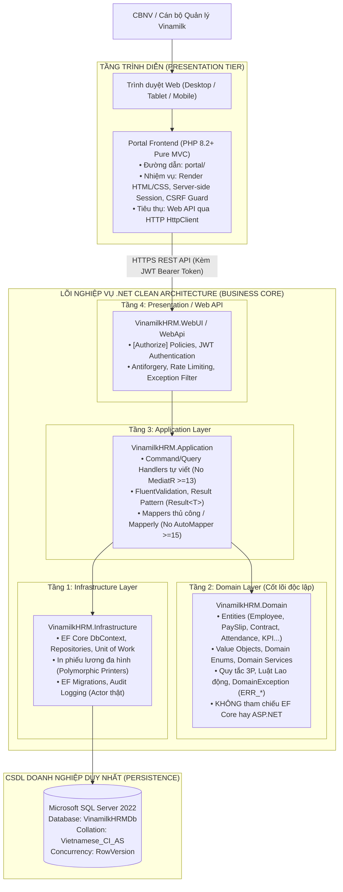

# TÀI LIỆU THIẾT KẾ KIẾN TRÚC ĐÍCH 4 TẦNG (TARGET ARCHITECTURE DESIGN)
## Dự án: Vinamilk Enterprise HRM
**Tổ chức**: Công ty Cổ phần Sữa Việt Nam (Vinamilk)  
**Quy mô**: ~10.000 Cán bộ Nhân viên (Trụ sở, 4 Nhà máy Sữa, 2 Trang trại Green Farm, Chi nhánh kinh doanh, Chuỗi Giấc Mơ Sữa Việt)  
**Tác giả**: Principal Software Architect & Lead Security Engineer  
**Phiên bản**: 2.0 (Phiên 0 - Kiến trúc chuyển đổi tổng thể)

---

## 1. TỔNG QUAN KIẾN TRÚC ĐÍCH (SYSTEM OVERVIEW)

Hệ thống Vinamilk HRM chuyển dịch từ mô hình phân tán 3 lớp song song sang kiến trúc doanh nghiệp chuẩn mực:
- **Lõi nghiệp vụ duy nhất (Single Source of Business Truth)**: Backend **.NET Clean Architecture** trong thư mục `VinamilkHRM/`.
- **Cơ sở dữ liệu duy nhất (Single Database)**: **SQL Server 2022 (`VinamilkHRMDb`)**. .NET là nơi duy nhất kết nối và ghi dữ liệu CSDL.
- **Giao diện Cổng thông tin (Web Portal Frontend)**: **PHP 8.2+ MVC thuần** trong thư mục `portal/`. PHP đóng vai trò giao diện hiển thị và gọi Web API từ .NET qua giao thức HTTP/JSON, lưu trữ JWT an toàn trong Session phía máy chủ, hoàn toàn không tính toán quy tắc nghiệp vụ và không kết nối trực tiếp CSDL.
- **Giao diện di sản (Legacy UI)**: SPA tĩnh trong `docs/legacy-ui/` chỉ phục vụ mục đích tra cứu và tham khảo trải nghiệm người dùng.



---

## 2. CHI TIẾT 4 TẦNG CLEAN ARCHITECTURE CỦA .NET BACKEND

Kiến trúc tuân thủ nguyên tắc phụ thuộc một chiều hướng tâm (Dependency Inversion Principle). Các tầng ngoài phụ thuộc vào tầng trong, tầng Domain nằm ở trung tâm và tuyệt đối độc lập:

```
[VinamilkHRM.WebUI / WebApi]  ──►  [VinamilkHRM.Application]  ──►  [VinamilkHRM.Domain]
             ▲                                ▲                           ▲
             │                                │                           │
             └────────────────── [VinamilkHRM.Infrastructure] ─────────────┘
```

### 2.1. Tầng Domain (`VinamilkHRM.Domain`)
- **Vai trò**: Trái tim của toàn bộ hệ thống, mô hình hóa thế giới thực của Tập đoàn Vinamilk.
- **Thành phần**:
  - **Entities**: Mô hình kế thừa đa hình (Polymorphism) phản ánh cơ cấu nhân sự phức tạp:
    - `Employee` làm gốc $\rightarrow$ phân nhánh `OfficeEmployee` (Văn phòng Trụ sở), `FactoryWorker` (Công nhân 4 Nhà máy Sữa), `FarmSpecialist` (Chuyên viên 2 Trang trại Green Farm), `StoreAssociate` (Nhân viên chuỗi Giấc Mơ Sữa Việt).
    - `LaborContract` $\rightarrow$ `ProbationContract`, `DefiniteContract`, `IndefiniteContract`.
    - `OrganizationalUnit` $\rightarrow$ `HeadquartersUnit`, `FactoryUnit`, `DairyFarmUnit`, `RetailStoreUnit`.
    - `PaySlip`, `Attendance`, `LeaveRequest`, `KpiAssignment`, `CompanyAsset`, `AuditLog`.
  - **Enums**: `ContractType`, `KpiStatus`, `PaySlipStatus`, `UnitType`, `RegionScope`.
  - **Quy tắc tính toán**:
    - Tiền VND sử dụng kiểu dữ liệu `decimal(18,0)`, quy tắc làm tròn số học `MidpointRounding.AwayFromZero`.
    - Ngày công sử dụng kiểu `DateOnly`; giờ giấc sử dụng `TimeOnly`.
    - Thời điểm kiểm toán sử dụng `DateTimeOffset` theo chuẩn UTC; hiển thị theo múi giờ Việt Nam (`Asia/Ho_Chi_Minh`).
  - **Domain Exceptions**: Mọi lỗi vi phạm quy tắc nghiệp vụ đều ném `DomainException` kèm mã định danh bắt đầu bằng tiền tố `ERR_*` (ví dụ: `ERR_PAYROLL_LOCKED`, `ERR_LEAVE_BALANCE_EXCEEDED`, `ERR_KPI_INVALID_WEIGHT`).
  - **Độc lập tuyệt đối**: Không chứa bất kỳ tham chiếu nào đến Microsoft.EntityFrameworkCore hay Microsoft.AspNetCore.

### 2.2. Tầng Application (`VinamilkHRM.Application`)
- **Vai trò**: Điều phối luồng nghiệp vụ (Orchestration) và thực thi các ca sử dụng (Use Cases).
- **Thành phần**:
  - **Command / Query Pattern tự viết**: Tự định nghĩa các interface `ICommand<TResult>`, `IQuery<TResult>`, `ICommandHandler<TCommand, TResult>` mà **không phụ thuộc vào MediatR >= 13** (nhằm đảm bảo tuân thủ giấy phép nguồn mở phi thương mại).
  - **Mã phản hồi chuẩn (Result Pattern)**: Mọi handler trả về đối tượng `Result<T>` hoặc `Result.Success()`, `Result.Failure(error)` thay vì ném exception ngoài tầm kiểm soát.
  - **Xác thực dữ liệu đầu vào**: Sử dụng thư viện `FluentValidation` để kiểm tra tính hợp lệ của Request DTOs trước khi xử lý nghiệp vụ.
  - **Ánh xạ DTO (Object Mapping)**: Thực hiện ánh xạ thủ công hoặc sử dụng thư viện compile-time `Mapperly`, **không sử dụng AutoMapper >= 15**.
  - **Dịch vụ nghiệp vụ (Application Services)**:
    - `PayrollService`: Động cơ tính lương 3P, tích hợp bảo hiểm bắt buộc và biểu thuế TNCN 2026.
    - `KpiService`: Tính điểm trung bình KPI theo trọng số, phân loại A/B/C/D.
    - `ScopeService`: Áp dụng bộ lọc phân vùng đa điểm theo chi nhánh miền.

### 2.3. Tầng Infrastructure (`VinamilkHRM.Infrastructure`)
- **Vai trò**: Triển khai các giao tiếp ngoại vi, kết nối phần cứng, dịch vụ bên ngoài và truy xuất cơ sở dữ liệu.
- **Thành phần**:
  - **Entity Framework Core 10 / 9**:
    - `VinamilkHRMDbContext`: Kế thừa `DbContext`, triển khai interface `IApplicationDbContext`.
    - Cấu hình Fluent API độc lập cho từng thực thể trong thư mục `Data/Configurations/`.
    - **Nghiêm cấm bật Lazy Loading**: Sử dụng Eager Loading (`Include`, `ThenInclude`) có chọn lọc hoặc phép chiếu `Select` để phòng chống lỗi N+1 Query.
    - **Quản lý tương tranh lạc quan (Optimistic Concurrency)**: Sử dụng cột `RowVersion` kiểu `byte[]` (`ROWVERSION` trong SQL Server) cho các bảng giao dịch quan trọng.
  - **Triển khai Repositories & Unit of Work**: Cung cấp các thao tác CRUD trừu tượng và tối ưu hóa truy vấn qua `IUnitOfWork`.
  - **In ấn phiếu lương đa hình (Polymorphic Printing)**:
    - Cung cấp các dịch vụ sinh định dạng phiếu lương đặc thù cho từng khối đơn vị: `OfficePayslipPrinter`, `FactoryPayslipPrinter`, `RetailStorePayslipPrinter` thông qua `PayslipPrinterFactory`.
  - **Nhật ký kiểm toán tự động (Audit Interceptor)**: Ghi nhận vết thay đổi dữ liệu nhạy cảm vào bảng `AuditLogs` với định danh `UserId` thực tế lấy từ `ICurrentUserService`.

### 2.4. Tầng Web API / WebUI (`VinamilkHRM.WebUI`)
- **Vai trò**: Điểm tiếp nhận các yêu cầu HTTP từ Web Portal PHP và các ứng dụng vệ tinh.
- **Thành phần**:
  - **Xác thực & Phân quyền (Authentication & Authorization)**:
    - Cung cấp endpoint đăng nhập cấp phát token bảo mật `JSON Web Token (JWT)`.
    - Mọi endpoint nghiệp vụ bắt buộc được bảo vệ bởi thuộc tính `[Authorize]` kết hợp Policy dựa trên Role và Scope.
  - **Phòng chống tấn công (Security Middleware)**:
    - Cấu hình Antiforgery Header validation.
    - Rate Limiting giới hạn tần suất yêu cầu chống tấn công từ chối dịch vụ (DDoS / Brute Force).
    - Global Exception Handler định dạng mọi lỗi thành cấu trúc chuẩn `ProblemDetails` (RFC 7807), không rò rỉ stack trace.

---

## 3. KIẾN TRÚC FRONTEND WEB PORTAL (PHP 8.2+ MVC)

Portal PHP đóng vai trò là tầng giao diện mỏng (BFF - Backend for Frontend), tối ưu hóa trải nghiệm người dùng cuối:

```
[Trình duyệt Người dùng] 
       │ 
       ▼ (HTTP Request)
[portal/public/index.php] (Front Controller)
       │
       ▼
   [portal/app/core/App.php] (Router)
       │
       ▼
 [Controllers (PHP MVC)]
       ├── Kiểm tra Session & CSRF Token
       ├── Đính kèm JWT Token của người dùng
       ├── Gọi Web API sang .NET Backend qua HttpClient (cURL / Guzzle)
       │         ▲
       │         │ (JSON Response: Result<T>)
       │         ▼
       └── Render View (PHP thuần, nhúng Master Layout chuẩn Vinamilk)
```

### Các nguyên tắc bắt buộc cho Portal PHP:
1. **declare(strict_types=1)**: 100% file PHP khai báo kiểu dữ liệu nghiêm ngặt.
2. **PSR-12**: Tuân thủ tiêu chuẩn định dạng mã nguồn quốc tế.
3. **Không tính toán nghiệp vụ cốt lõi**: Mọi phép tính tiền lương, thuế TNCN, bảo hiểm, trừ phép, tính công đều do .NET trả về. PHP chỉ hiển thị số liệu đã tính.
4. **Không kết nối trực tiếp CSDL**: Mọi thao tác đọc/ghi đều đi qua REST API của .NET.
5. **Escape dữ liệu đầu ra**: Áp dụng hàm `e()` / `htmlspecialchars($str, ENT_QUOTES, 'UTF-8')` chống XSS.
6. **Bảo mật Form & Request**: Kiểm tra `csrf_token()` trên mọi thao tác `POST`, `PUT`, `DELETE`.

---

## 4. QUY TRÌNH QUẢN LÝ CƠ SỞ DỮ LIỆU & SCHEMA MIGRATIONS

- **Hệ quản trị CSDL đích**: Microsoft SQL Server 2022 (`VinamilkHRMDb`).
- **Collation bắt buộc**: `Vietnamese_CI_AS` (hỗ trợ sắp xếp và tìm kiếm tiếng Việt toàn diện).
- **Nguyên tắc quản lý schema**:
  1. Mọi sự thay đổi về cấu trúc bảng, cột, khóa ngoại, chỉ mục đều phải được thực hiện thông qua **EF Core Migrations**. Tuyệt đối không chỉnh sửa cấu trúc bảng trực tiếp trên CSDL bằng các câu lệnh thủ công trên SSMS.
  2. Các script nạp schema hoặc triển khai cho môi trường Staging/Production phải được sinh tự động bằng lệnh:
     ```bash
     dotnet ef migrations script --idempotent --context VinamilkHRMDbContext -o migrations.sql
     ```
  3. **Nguyên tắc không phá hủy**: Không bao giờ sử dụng lệnh `DROP TABLE` hoặc `DROP COLUMN` chứa dữ liệu trên môi trường vận hành thực tế.
  4. **Tính bất biến của kỳ lương/kỳ công**: Bảng lương và bảng công sau khi được ký duyệt (`Approved`) và chi trả (`Paid`) sẽ bị khóa cứng (IsLocked = 1). Mọi điều chỉnh do sai sót dữ liệu quá khứ phải được thực hiện dưới dạng bản ghi bổ sung (Arrears/Adjustments) trong kỳ lương tiếp theo.

---

## 5. MÔ HÌNH BẢO MẬT DOANH NGHIỆP (SECURITY ARCHITECTURE)

```
┌────────────────────────────────────────────────────────────────────────┐
│                        CÁC LỚP BẢO VỆ ĐA TẦNG                          │
├────────────────────────────────────────────────────────────────────────┤
│ 1. Network / Transport:  HTTPS TLS 1.3, HSTS Header                    │
│ 2. Frontend / Portal:    CSRF Token, XSS Output Escaping, HttpOnly     │
│ 3. API Boundary:         JWT Bearer Authentication, Rate Limiting      │
│ 4. Authorization:        Role-Based (7 Nhóm vai trò Vinamilk)          │
│                          Scope-Based (Cây đơn vị đệ quy scopeByUnit)    │
│ 5. Concurrency:          RowVersion Optimistic Concurrency Control     │
│ 6. Auditing & Tracing:   AuditLog lưu UserId thật, IP, Giá trị Cũ/Mới  │
└────────────────────────────────────────────────────────────────────────┘
```

Kiến trúc này đảm bảo hệ thống vận hành an toàn, tin cậy, đáp ứng đầy đủ yêu cầu quản trị nhân sự cho quy mô 10.000 cán bộ nhân viên của Tập đoàn Vinamilk.
